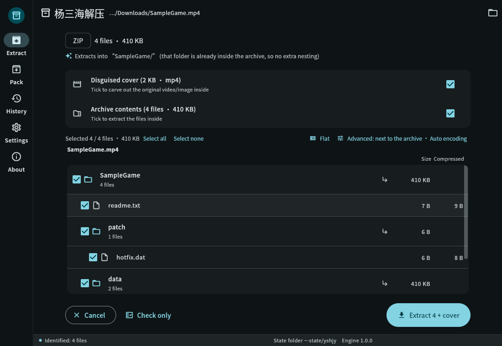
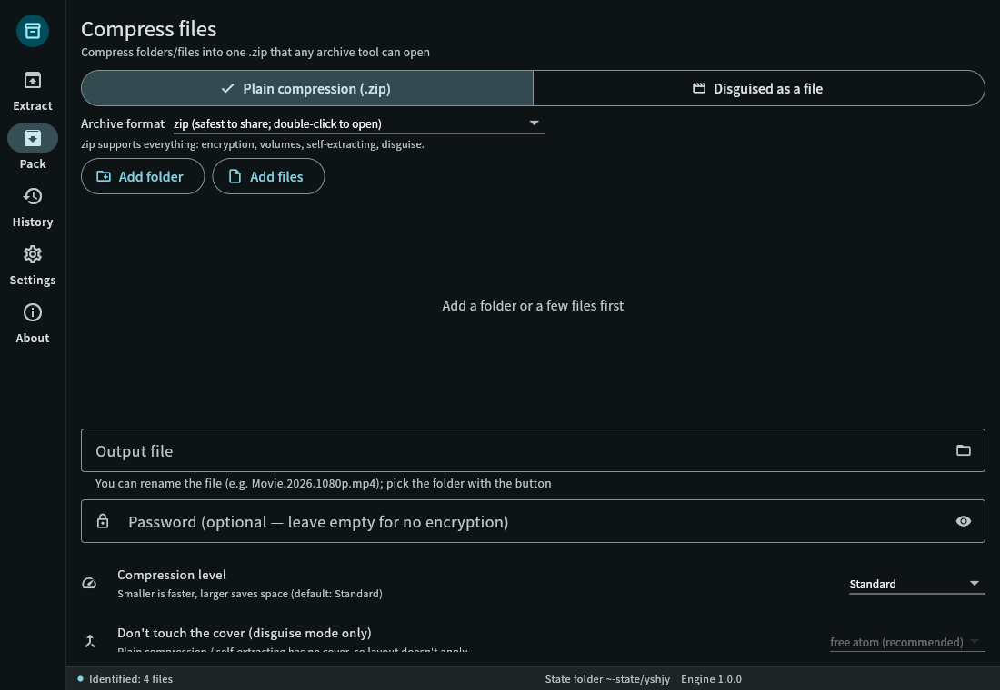
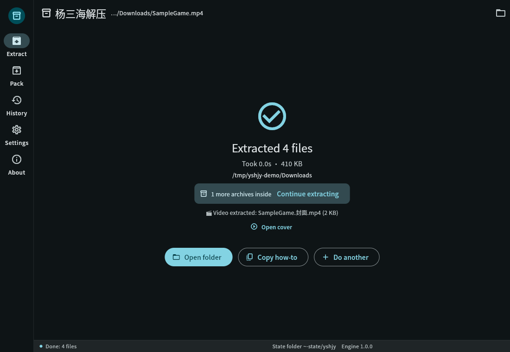
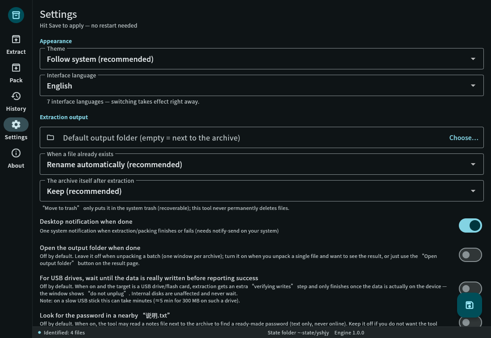
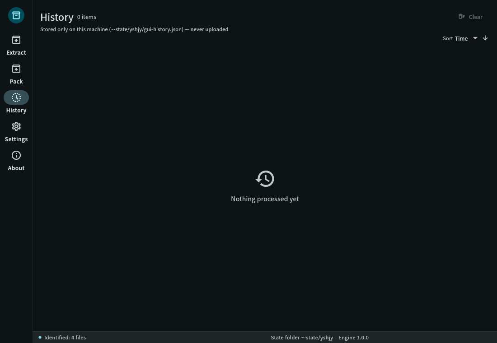
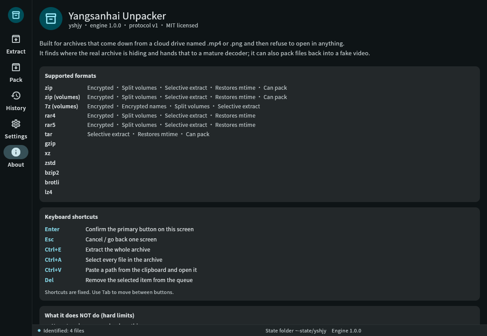

# yshjy — Yang Sanhai Extractor

> **Turn an archive disguised as a video/photo back into real files, in one step.**
> Those ".mp4" files from cloud drives that no tool will open? Just drop them in.

[简体中文](README.md) ｜ [繁體中文](README.zh-TW.md) ｜ **English** ｜ [日本語](README.ja.md) ｜ [한국어](README.ko.md) ｜ [Русский](README.ru.md) ｜ [Español](README.es.md)

[](LICENSE)


<p align="center">
  
  
  
</p>

---

## 😵 Why this project exists

You download a resource pack, and it is a pile of `.mp4` files plus a readme saying:

> "Password: xxxx — rename every MP4 to .zip, then extract with WinRAR"

So you do it, and then:

- Renamed, double-clicked → **"The file is corrupt"** ❌
- Tried 7-Zip, tried the phone's built-in extractor → **"Not an archive"** ❌
- Someone on a forum mentions "#mode" → **you cannot find it anywhere** ❌
- You re-download it, or just give up

The reason is simple. Those "videos" are archives stuffed into an MP4 shell by a tool
(to slip past cloud-drive content scanning) — and the archive's own directory table was
**deliberately corrupted**, so every standard extractor declares it damaged.
**They are not broken. They were made to look broken.**

Every extractor on the market is waiting for a *normal* archive; nobody handles the
"looks broken" kind. So I wrote yshjy: **no renaming, no "#mode", no 7-Zip required.**
Drop the file in, or run one command.

---

## ✨ What it does

**Extracting**

- Recognises an archive by content, not by extension (`.mp4` / `.jpg` / `.pdf` all fine;
  a single file containing two archives is handled too)
- **Chinese filenames don't turn into garbage**, and **Chinese passwords need no setup**
  (GBK-encoded archives just work)
- Archives with a corrupted directory table are repaired **in memory** before extraction —
  **not one byte on disk is touched**
- Multi-volume archives are joined automatically: 7z volumes, RAR volumes, ZIP `.z01/.z02…`,
  and raw splits `.001/.002…`
- `--list` shows what's inside before you commit; extract only the parts you want
- When it finishes it tells you **where it went and whether more archives are inside**
  (nested ones are pulled out for you)
- If the directory table is gone entirely, **rescue mode** rebuilds the listing from each
  file's header — you get whatever can still be saved
- Batch mode: queue a whole folder, one bad file doesn't stop the rest

**Packing (the reverse direction)**

- Disguise files as a video or image (MP4 gets a real `free` atom layout; other containers
  get a tail-append)
- Every package is **read back and verified** before it's reported as done — you never get
  a "looks fine, actually broken" result
- Optional volumes, password, decoy data, cover video

**Everyday use**

- GUI with 5 pages and **7 interface languages** (简体中文 / 繁體中文 / English / 日本語 /
  한국어 / Русский / Español)
- **Both pages accept drag & drop**: drop on the home page to extract, drop on Pack to pack
- CLI in the same 7 languages, scriptable (`--json` streams one event per line)
- **Fully offline**: there is not a single line of networking code in the program —
  it isn't "we promise not to upload", it simply has no ability to
- Linux .deb ships a menu entry and 14 file-type context-menu entries; the Windows installer
  registers 22 extensions plus a folder context menu
- Two builds: **standard** (everyday formats, small, recommended) and **full**
  (headroom for rare formats — coverage is identical today)

---

## 🖼 Screenshots

| Preview | Pack | Settings |
|---|---|---|
|  |  |  |

| Result | History | About |
|---|---|---|
|  |  |  |

Chinese screenshots are in `data/screenshots/`. Switch language under
**Settings → Interface language**; it applies immediately, no restart.

---

## ✅ Command line in 20 seconds

```bash
# Extract — that's the whole thing
yshjy movie.mp4

# Look inside first, without extracting
yshjy --list movie.mp4

# With a password
yshjy -p "correct horse" game.mp4

# Queue a whole folder (one failure doesn't stop the rest, big ones first)
yshjy Downloads/games/

# Only part of the archive
yshjy --select "*.exe" game.mp4          # only .exe files
yshjy --select "data/**" game.mp4        # only one directory
yshjy --select required game.mp4         # skip .DS_Store and friends

# Two at a time (default is sequential — the gentlest on disk)
yshjy --jobs 2 Downloads/games/

# Machine-readable event stream
yshjy --json archive.mp4 | jq .

# Force rescue on a damaged archive
yshjy --rescue broken.zip

# Pack: disguise files as a video
yshjy ys MyGame/
yshjy ys MyGame/ -p "password"           # encrypted
yshjy ys MyGame/ --split 2G              # 2 GB volumes

# Something won't open? Produce a diagnostic bundle you can attach to an issue
yshjy --report archive.mp4
yshjy --report --no-paths archive.mp4    # paths redacted (use this for public posts)
```

**Tried on real files, not demo data:**

| Case | Result |
|---|---|
| An 8.7 GB disguised archive (8 GiB inner volumes + a Chinese password) | fully extracted, byte-for-byte identical to the original |
| Listing that same 8.7 GB file without extracting | **0.09 s** |
| Pack, then extract again | output identical to the input files |

---

## 📦 Which file do I download?

**Linux**

| File | Install | Good for |
|---|---|---|
| `yshjy_1.0.0_amd64.deb` | `sudo apt install ./yshjy_1.0.0_amd64.deb` | Most people: menu entry + context menu |
| `yshjy-1.0.0-linux-x86_64.tar.gz` (standard) | unpack, put `yshjy` in `~/.local/bin/` | No package manager, CLI only |
| `yshjy-full-1.0.0-linux-x86_64.tar.gz` (full) | same | Headroom for rare formats (identical coverage today) |

**Windows**

| File | How | Good for |
|---|---|---|
| `yshjy-1.0.0-setup.exe` | double-click (per-user install, no UAC prompt) | Most people: 22 extensions + folder context menu |
| `yshjy-1.0.0-win-x64.zip` (portable) | unpack anywhere, run `yshjy_gui.exe` | No install, runs from a USB stick |
| `yshjy-1.0.0-win-x64-cli.zip` (CLI) | unpack, add the folder to PATH | Scripts, batch jobs |

> The Windows builds bundle the VC++ runtime (`msvcp140` / `vcruntime140` /
> `vcruntime140_1`), so a clean Windows machine needs nothing installed first.
> All three ship with `SHA256SUMS.txt`.

---

## 📋 Format support

| Area | Supported | Notes |
|---|---|---|
| **Extract** | ZIP (incl. ZIP64), 7z, RAR (1.3 → 7), TAR, GZIP, XZ, ZSTD, BZIP2, BROTLI, LZ4 | empty files, directories, symlinks, long paths all handled |
| **Encryption** | ZipCrypto, AES-256, 7z AES-256 | non-ASCII passwords work without configuration |
| **Volumes** | 7z volumes, RAR volumes, ZIP `.z01/.z02…`, raw split `.001/.002…` | missing volume is reported as such, never silently skipped |
| **Disguise containers** | any: MP4 uses a real `free` atom, everything else gets a tail append | images and PDFs tested too |
| **Rescue** | ZIP offset repair + local header rebuild + ZIP64 extra | other formats not yet |
| **Pack** | ZIP / 7z (volumes, password) | RAR is not produced (see below) |

> Built on **open-source** implementations only. RAR is extract-only because RAR's official
> licence forbids producing archives. Core features have **zero external program
> dependencies** — you do not need 7-Zip, WinRAR or unrar installed.
>
> **The single exception is the "MKV attachment" layout** (`--layout L8`): it calls the
> **ffmpeg** already on your system ([ffmpeg.org](https://ffmpeg.org/), LGPL/GPL free
> software) to remux the cover video into MKV and stores the archive as an attachment.
> We do not bundle, modify or redistribute ffmpeg — it is called once, only if **you**
> installed it. Without ffmpeg the tool falls back to the `free`-atom layout and says so;
> it will never write a fake MKV just to look successful. Everything else works without ffmpeg.

---

## 🆚 Compared with ordinary extractors

| Capability | Typical tools | **yshjy** |
|---|---|---|
| Identify by content, ignore the extension | partial | ✅ |
| Find an archive hidden mid-file or at the end | ✗ | ✅ (including several archives in one file) |
| Non-ASCII filenames stay readable | ✗ (GBK archives always garble) | ✅ four-tier fallback (UTF-8 flag → UTF-8 → GB18030 → last resort) |
| Non-ASCII password needs no setup | ✗ (manual encoding switch) | ✅ |
| Repair a corrupted directory table | ✗ | ✅ in memory, source untouched |
| Rescue mode when the table is unsalvageable | ✗ | ✅ rebuilds the listing from file headers |
| Verify its own output when packing | ✗ | ✅ reads back and fails loudly |
| Graphical interface | ✗ (almost all are CLI) | ✅ Linux + Windows, 5 pages, 7 languages |
| Fully offline | sometimes | ✅ no networking code at all |

**In one line:** other tools say "the file is corrupt". This one tells you
**what happened, why, and how much can still be saved.**

---

## 🔧 Build from source

```bash
# Rust 1.85+ (edition 2024)
git clone https://github.com/yangsanhai/yshjy
cd yshjy
cargo build --release
# output: target/release/yshjy (single file, ~9 MB, no external dependencies)

install -Dm755 target/release/yshjy ~/.local/bin/yshjy   # CLI only

# GUI (needs Flutter 3.44+)
cd gui && flutter build linux --release && cd ..
bash scripts/build-deb.sh     # produces a .deb under dist/
```

Tests:

```bash
cargo test                                   # Rust unit tests
cargo clippy --all-targets -- -D warnings    # static checks
bash tests/all.sh                            # full regression (a few minutes)
cd gui && flutter test                       # UI tests
```

---

## 🌍 Interface languages (7)

简体中文 · 繁體中文 · English · 日本語 · 한국어 · Русский · Español

- Switch under **Settings → Interface language**; takes effect immediately
- CLI: `--lang en` (or `ja` / `ko` / `ru` / `es` / `zh-TW`)
- Want your own language? Drop a `.toml` in `locales/` and a `.json` in
  `gui/assets/l10n/` — **no code changes needed**; missing keys fall back to English
  instead of showing blanks or tofu boxes

---

## 💥 It crashed — how do I report it?

1. Run `yshjy --report`
   This writes `yshjy-report-<time>.zip` in the current directory with the most recent crash
   record (the `crash/` folder: where it died, the backtrace, the command line —
   **passwords already redacted to `<redacted>`**)
2. Attach that zip to an issue

No bundle needed? The log lives in `~/.local/state/yshjy/crash/`
(Windows: `%LOCALAPPDATA%\yshjy\crash\`).

Before posting publicly, run `yshjy --report --no-paths` — paths become `<home>`-style
placeholders instead of your username.

> Nothing is ever uploaded automatically (the program has no networking code at all).
> Whether you send it, and to whom, is entirely your call.

---

## ❓ FAQ

**Q: Why not just use WinRAR / 7-Zip?**
A: They cannot *see* an archive that sits in the middle of a video, or one whose directory
table was corrupted. That is by design, not a bug. WinRAR is also paid software on Windows
and unavailable on Linux.

**Q: Can it read an encrypted archive's password?**
A: No — that is mathematically impossible, and the whole point of encryption. It can tell
you **how many entries are locked before extracting**, so you can confirm the password you
were given is the right one instead of discovering it halfway through.

**Q: So what does "automatic password trying" actually do?**
A: On an encrypted archive **you already have**, it tries the passwords **you** wrote down,
one by one (checking the first few KB of an encrypted entry is enough to verify). It cannot
log in anywhere and cannot reach another machine — breaking into a computer requires a
remote entry point on that machine, which is several layers above an extractor.

**Q: Any security risk?**
A: Built-in defences: path traversal blocking (`../../etc/passwd`), zip-bomb guards
(compression ratio plus total size), and a warning when executables come out. But be
honest with yourself: these "rename and extract" packs are a malware hotspot. Scan before
you run.

**Q: Can it give me a complete, playable video?**
A: Yes. `yshjy --extract-cover archive.mp4`, or tick only "Disguised cover" in the GUI —
the cover is already a complete MP4 and is lifted out untouched.

**Q: Does it modify my source files?**
A: **Never.** Every repair happens in memory; the file on disk is untouched, byte for byte.

**Q: Why extract RAR but not create RAR?**
A: RAR's compression algorithm is proprietary and its licence allows extraction only.
This project uses open-source implementations exclusively.

**Q: Mobile?**
A: Android **works today** — grab the `arm64` or `armv7` APK from the download page
(Android 7.0+). iOS is not available yet; that needs a Mac to build.

---

## 🚫 Things this tool deliberately does not do

These are not "not yet" — they are **out of scope by design**. Writing the line down
saves everyone a misunderstanding.

- **No dictionary attacks, no brute force.** Password candidates come from exactly two
  places: passphrases **you** recorded, and passphrases the packer **published next to the
  archive** in a readme.
- **No built-in common-password list.** That would be shipping a small dictionary.
- **No dictionary-file option, and the candidate cap is hard.** `max_candidates` has a hard
  ceiling; no configuration turns this into a brute-forcer (a test enforces it).
- **No network, no uploads.** Not "we promise not to send" — there is **no networking code
  in the program at all**.
- **No password harvesting.** Passwords scraped from a readme are **tried and discarded**,
  never written into your password book. That book is yours to edit, or to fill via
  `--import-passwords`.
- **No modification of your files.** Every repair is done in memory.

**The real risk is the archives other people hand you.** These packs are a malware hotspot.
The tool defends (blocks `../` traversal, guards against zip bombs, warns on executables),
but **scan before you run**.

Also: **reverse packing** (`ys`) can disguise files as a video, and that capability can be
used to deceive. Use it for your own backups and lawful sharing only (see the disclaimer).

---

## 🛠 Design & developer docs

- `DESIGN.md` — product design (requirements, features, decision log)
- `docs/ARCHITECTURE.md` — architecture
- `docs/INTERNALS.md` — **internal overview**: what the code looks like today (module
  responsibilities, dependencies, mechanisms, generated by `scripts/scan-src.py`)
- `docs/TODO.md` — the **single source of truth** for completeness
- `docs/CLI-SPEC.md` / `docs/UI-SPEC.md` — CLI and UI specifications
- the rest of `docs/` — per-format measurements and the pitfalls hit along the way

Want to contribute? See [CONTRIBUTING.md](CONTRIBUTING.md).

---

## 💖 Supporting the project

- Star the repo — the most useful thing you can do, and free
- Open an issue about a pack that failed: **attach the `yshjy --report` bundle**, that is
  the most valuable contribution there is
- Donation channels aren't set up yet; they'll be listed here when they are

---

## ⚖️ Licence & disclaimer

This project is released under the [MIT Licence](LICENSE): free to use, modify and redistribute, including commercially. The only requirement is keeping the copyright notice and the licence text (see `LICENSE` and the header of each source file).

Bundled third-party libraries keep their own licences; the full list and licence texts ship with the app under About → Open-source licences. None of it needs a network connection.

**Disclaimer**: intended for personal backup and lawful sharing only. Do not use it to evade the law or distribute infringing content. You are responsible for how you use it.
