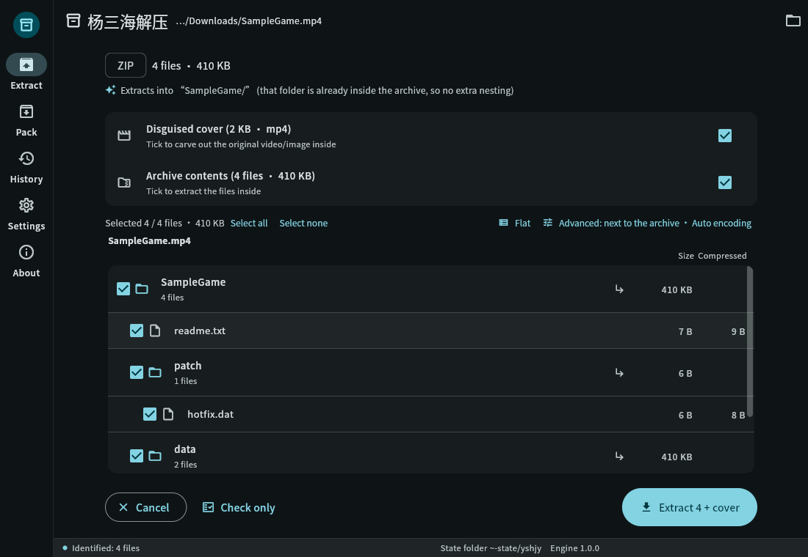
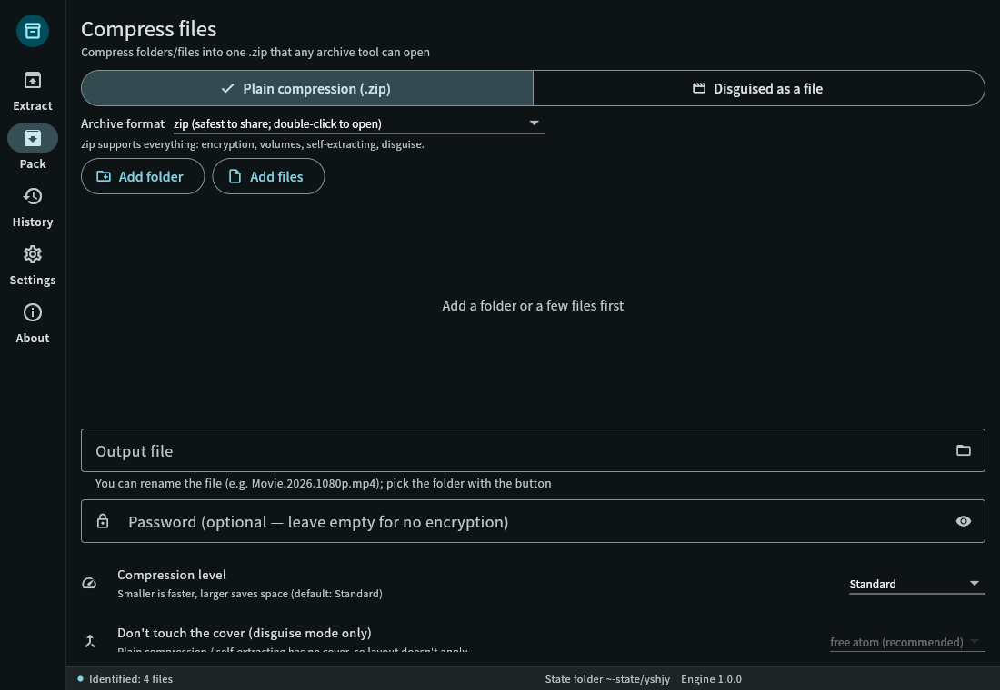
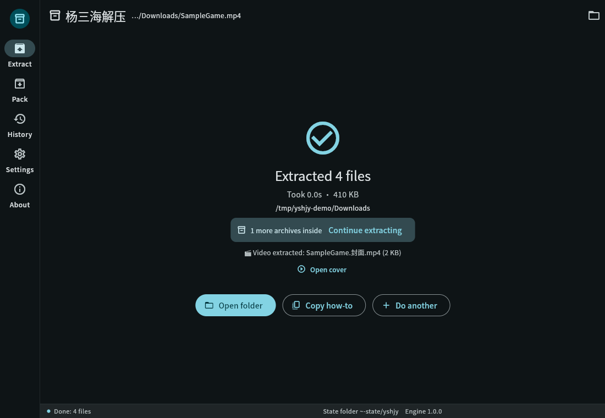
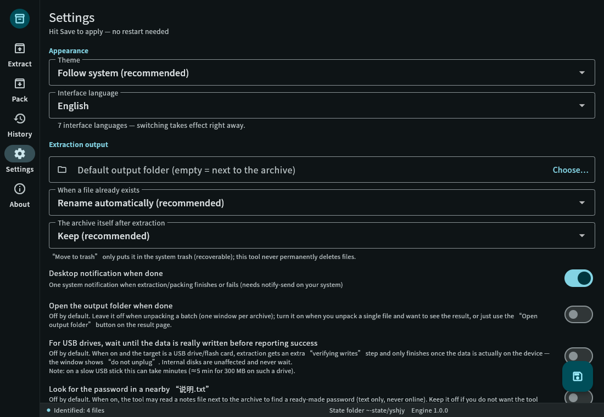
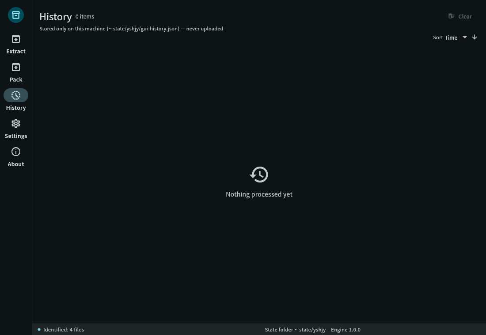
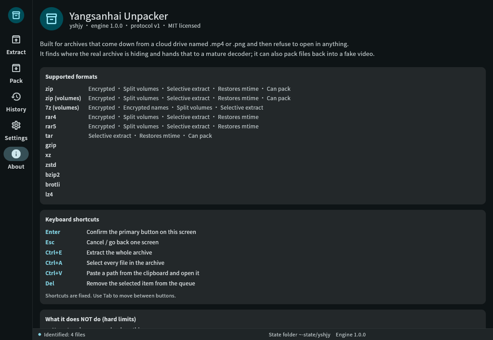

# yshjy — Extractor Yang Sanhai

> **Convierte un archivo disfrazado de video/foto de vuelta a archivos reales, en un solo paso.**
> ¿Esos archivos ".mp4" de unidades en la nube que ninguna herramienta abre? Solo arrástralos.

[简体中文](README.md) ｜ [繁體中文](README.zh-TW.md) ｜ [English](README.en.md) ｜ [日本語](README.ja.md) ｜ [한국어](README.ko.md) ｜ [Русский](README.ru.md) ｜ **Español**

[](LICENSE)


<p align="center">
  
  
  
</p>

---

## 😵 Por qué existe este proyecto

Descargas un paquete de recursos y es un montón de archivos `.mp4` más un leeme que dice:

> "Contraseña: xxxx — renombra cada MP4 a .zip y luego extrae con WinRAR"

Entonces lo haces, y luego:

- Renombrado, doble clic → **"El archivo está corrupto"** ❌
- Probaste 7-Zip, el extractor integrado del teléfono → **"No es un archivo"** ❌
- Alguien en un foro menciona "#mode" → **no lo encuentras en ningún lado** ❌
- Vuelves a descargarlo o simplemente te rindes

La razón es simple. Esos "videos" son archivos comprimidos metidos en una estructura MP4 por una herramienta
(para colarse en el escaneo de contenido de unidades en la nube) — y **la tabla de directorios del archivo
fue deliberadamente corrompida**, por lo que cada extractor estándar lo declara dañado.
**No están rotos. Fueron hechos para parecer rotos.**

Cada extractor en el mercado espera un archivo *normal*; nadie maneja el tipo "parece roto".
Por eso escribí yshjy: **sin renombrar, sin "#mode", sin necesidad de 7-Zip.**
Arrastra el archivo o ejecuta un comando.

---

## ✨ Qué hace

**Extracción**

- Reconoce un archivo por su contenido, no por su extensión (`.mp4` / `.jpg` / `.pdf` todos válidos;
  un solo archivo que contiene dos archivos comprimidos también se maneja)
- **Los nombres de archivo en chino no se convierten en basura**, y **las contraseñas en chino no requieren configuración**
  (los archivos codificados en GBK simplemente funcionan)
- Los archivos con una tabla de directorios corrompida se reparan **en memoria** antes de la extracción —
  **no se toca ni un solo byte en el disco**
- Los archivos multivolumen se unen automáticamente: volúmenes 7z, volúmenes RAR, ZIP `.z01/.z02…`,
  y divisiones crudas `.001/.002…`
- `--list` muestra qué hay dentro antes de confirmar; extrae solo las partes que quieras
- Al terminar, te dice **dónde quedó y si hay más archivos dentro**
  (los anidados se extraen para ti)
- Si la tabla de directorios desapareció por completo, el **modo de rescate** reconstruye el listado a partir del
  encabezado de cada archivo — obtienes lo que aún se pueda salvar
- Modo por lotes: pon en cola una carpeta entera, un archivo malo no detiene el resto

**Empaquetado (la dirección inversa)**

- Disfraza archivos como un video o imagen (MP4 obtiene un diseño de átomo `free` real; otros contenedores
  obtienen un apéndice al final)
- Cada paquete es **leído de vuelta y verificado** antes de reportarse como listo — nunca obtienes
  un resultado "parece bien, pero en realidad está roto"
- Opcional: volúmenes, contraseña, datos señuelo, video de portada

**Uso cotidiano**

- Interfaz gráfica con 5 páginas y **7 idiomas de interfaz** (简体中文 / 繁體中文 / English / 日本語 /
  한국어 / Русский / Español)
- **Ambas páginas aceptan arrastrar y soltar**: arrastra en la página principal para extraer, arrastra en Empaquetar para empaquetar
- CLI en los mismos 7 idiomas, scriptable (`--json` transmite un evento por línea)
- **Totalmente fuera de línea**: no hay ni una sola línea de código de red en el programa —
  no es "prometemos no subir nada", simplemente no tiene la capacidad de hacerlo
- En Linux, el .deb incluye una entrada de menú y 14 entradas de menú contextual por tipo de archivo; el instalador de Windows
  registra 22 extensiones más un menú contextual de carpeta
- Dos compilaciones: **estándar** (formatos cotidianos, pequeña, recomendada) y **completa**
  (margen para formatos raros — la cobertura es idéntica hoy)

---

## 🖼 Capturas de pantalla

| Vista previa | Empaquetar | Ajustes |
|---|---|---|
|  |  |  |

| Resultado | Historial | Acerca de |
|---|---|---|
|  |  |  |

Las capturas en chino están en `data/screenshots/`. Cambia el idioma en
**Ajustes → Idioma de la interfaz**; se aplica de inmediato, sin reiniciar.

---

## ✅ Línea de comandos en 20 segundos

```bash
# Extraer — eso es todo
yshjy movie.mp4

# Ver qué hay dentro primero, sin extraer
yshjy --list movie.mp4

# Con una contraseña
yshjy -p "correct horse" game.mp4

# Pon en cola una carpeta entera (un fallo no detiene el resto, los grandes primero)
yshjy Downloads/games/

# Solo parte del archivo
yshjy --select "*.exe" game.mp4          # solo archivos .exe
yshjy --select "data/**" game.mp4        # solo un directorio
yshjy --select required game.mp4         # omite .DS_Store y similares

# Dos a la vez (por defecto es secuencial — el más suave para el disco)
yshjy --jobs 2 Downloads/games/

# Flujo de eventos legible por máquina
yshjy --json archive.mp4 | jq .

# Forzar modo de rescate en un archivo dañado
yshjy --rescue broken.zip

# Empaquetar: disfrazar archivos como un video
yshjy ys MyGame/
yshjy ys MyGame/ -p "password"           # cifrado
yshjy ys MyGame/ --split 2G              # volúmenes de 2 GB

# ¿Algo no se abre? Genera un paquete de diagnóstico que puedes adjuntar a un problema
yshjy --report archive.mp4
yshjy --report --no-paths archive.mp4    # rutas redactadas (usa esto para publicaciones públicas)
```

**Medido con archivos reales, no datos de demostración:**

| Caso | Resultado |
|---|---|
| Archivo disfrazado real de 8.7 GB (volúmenes internos de 8 GiB + contraseña en chino) | extraídos **8,589,934,592 bytes**, SHA-256 **idéntico byte a byte** a un script escrito a mano |
| `--list` en ese mismo archivo de 8.7 GB | **0.09 s** (109 s antes de corregir el error "dejar que el crate zip detecte el desplazamiento") |
| Empaquetar → extraer ida y vuelta | `diff -r` limpio, autocomprobación aprobada |

---

## 📦 ¿Qué archivo descargo?

**Linux**

| Archivo | Instalación | Bueno para |
|---|---|---|
| `yshjy_1.0.0_amd64.deb` | `sudo apt install ./yshjy_1.0.0_amd64.deb` | La mayoría: entrada de menú + menú contextual |
| `yshjy-1.0.0-linux-x86_64.tar.gz` (estándar) | descomprimir, poner `yshjy` en `~/.local/bin/` | Sin gestor de paquetes, solo CLI |
| `yshjy-full-1.0.0-linux-x86_64.tar.gz` (completa) | igual | Margen para formatos raros (cobertura idéntica hoy) |

**Windows**

| Archivo | Cómo | Bueno para |
|---|---|---|
| `yshjy-1.0.0-setup.exe` | doble clic (instalación por usuario, sin solicitud de UAC) | La mayoría: 22 extensiones + menú contextual de carpeta |
| `yshjy-1.0.0-win-x64.zip` (portátil) | descomprimir en cualquier lugar, ejecutar `yshjy_gui.exe` | Sin instalación, se ejecuta desde una memoria USB |
| `yshjy-1.0.0-win-x64-cli.zip` (CLI) | descomprimir, agregar la carpeta a PATH | Scripts, trabajos por lotes |

> Las compilaciones para Windows incluyen el tiempo de ejecución de VC++ (`msvcp140` / `vcruntime140` /
> `vcruntime140_1`), por lo que una máquina Windows limpia no necesita nada instalado primero.
> Las tres incluyen `SHA256SUMS.txt`.

---

## 📋 Soporte de formatos 

| Área | Soportados | Notas |
|---|---|---|
| **Extraer** | ZIP (incl. ZIP64), 7z, RAR (1.3 → 7), TAR, GZIP, XZ, ZSTD, BZIP2, BROTLI, LZ4 | archivos vacíos, directorios, enlaces simbólicos, rutas largas todos manejados |
| **Cifrado** | ZipCrypto, AES-256, 7z AES-256 | contraseñas no ASCII funcionan sin configuración |
| **Volúmenes** | volúmenes 7z, volúmenes RAR, ZIP `.z01/.z02…`, división cruda `.001/.002…` | el volumen faltante se reporta como tal, nunca se omite en silencio |
| **Contenedores de disfraz** | cualquier: MP4 usa un átomo `free` real, todo lo demás obtiene un apéndice al final | imágenes y PDFs también probados |
| **Rescate** | reparación de desplazamiento ZIP + reconstrucción de encabezado local + extra ZIP64 | otros formatos aún no |
| **Empaquetar** | ZIP / 7z (volúmenes, contraseña) | RAR no se produce (ver abajo) |

> Construido **exclusivamente** sobre implementaciones de código abierto. RAR es solo para extracción porque
> la licencia oficial de RAR prohíbe producir archivos. Las funciones principales tienen **cero dependencias
> de programas externos** — no necesitas 7-Zip, WinRAR ni unrar instalados.
>
> **La única excepción es el diseño "adjunto MKV"** (`--layout L8`): llamará al
> **ffmpeg** ya instalado en tu sistema ([ffmpeg.org](https://ffmpeg.org/), software libre LGPL/GPL)
> para reempaquetar el video de portada en MKV y almacenar el archivo como un adjunto.
> No incluimos, modificamos ni redistribuimos ffmpeg — se llamará una vez, solo si **tú**
> lo instalaste. Sin ffmpeg, la herramienta retrocede al diseño de átomo `free` y lo indica;
> nunca escribirá un MKV falso solo para parecer exitoso. Todo lo demás funciona sin ffmpeg.

---

## 🆚 Comparación con extractores ordinarios

| Capacidad | Herramientas típicas | **yshjy** |
|---|---|---|
| Identificar por contenido, ignorar la extensión | parcial | ✅ |
| Encontrar un archivo oculto a mitad del archivo o al final | ✗ | ✅ (incluyendo varios archivos en un solo archivo) |
| Los nombres de archivo no ASCII siguen siendo legibles | ✗ (los archivos GBK siempre se corrompen) | ✅ retroceso de cuatro niveles (bandera UTF-8 → UTF-8 → GB18030 → último recurso) |
| La contraseña no ASCII no requiere configuración | ✗ (cambio manual de codificación) | ✅ |
| Reparar una tabla de directorios corrompida | ✗ | ✅ en memoria, sin tocar el original |
| Modo de rescate cuando la tabla no se puede recuperar | ✗ | ✅ reconstruye el listado a partir de los encabezados de los archivos |
| Verificar su propia salida al empaquetar | ✗ | ✅ lee de vuelta y falla claramente |
| Interfaz gráfica | ✗ (casi todas son CLI) | ✅ Linux + Windows, 5 páginas, 7 idiomas |
| Totalmente fuera de línea | a veces | ✅ sin código de red en absoluto |

**En una línea:** otras herramientas dicen "el archivo está corrupto". Esta te dice
**qué pasó, por qué y cuánto aún se puede salvar.**

---

## 🔧 Compilar desde el código fuente

```bash
# Rust 1.85+ (edición 2024)
git clone https://github.com/yangsanhai/yshjy
cd yshjy
cargo build --release
# salida: target/release/yshjy (archivo único, ~9 MB, sin dependencias externas)

install -Dm755 target/release/yshjy ~/.local/bin/yshjy   # solo CLI

# Interfaz gráfica (necesita Flutter 3.44+)
cd gui && flutter build linux --release && cd ..
bash scripts/build-deb.sh     # produce un .deb en dist/
```

Pruebas:

```bash
cargo test                                   # pruebas unitarias
cargo clippy --all-targets -- -D warnings    # comprobaciones estáticas (cero advertencias)
bash tests/all.sh                            # regresión completa (unos minutos)
cd gui && flutter test                       # pruebas de interfaz
```

---

## 🌍 Idiomas de interfaz (7)

简体中文 · 繁體中文 · English · 日本語 · 한국어 · Русский · Español

- Cambia en **Ajustes → Idioma de la interfaz**; se aplica de inmediato
- CLI: `--lang en` (o `ja` / `ko` / `ru` / `es` / `zh-TW`)
- ¿Quieres tu propio idioma? Coloca un archivo `.toml` en `locales/` y un `.json` en
  `gui/assets/l10n/` — **no se necesitan cambios en el código**; las claves faltantes retroceden a inglés
  en lugar de mostrar espacios en blanco o cajas tofu

---

## 💥 Se bloqueó — ¿cómo lo reporto?

1. Ejecuta `yshjy --report`
   Esto escribe `yshjy-report-<hora>.zip` en el directorio actual con el registro de bloqueo más reciente
   (la carpeta `crash/`: dónde se bloqueó, el rastro de pila, la línea de comandos —
   **las contraseñas ya están redactadas como `<redacted>`**)
2. Adjunta ese zip a un problema

¿No necesitas el paquete? El registro está en `~/.local/state/yshjy/crash/`
(Windows: `%LOCALAPPDATA%\yshjy\crash\`).

Antes de publicar públicamente, ejecuta `yshjy --report --no-paths` — las rutas se convierten en
marcadores de posición estilo `<home>` en lugar de tu nombre de usuario.

> Nada se sube automáticamente (el programa no tiene código de red en absoluto).
> Si lo envías, y a quién, depende completamente de ti.

---

## ❓ Preguntas frecuentes

**P: ¿Por qué no usar simplemente WinRAR / 7-Zip?**
R: No pueden *ver* un archivo que está en medio de un video, o uno cuya tabla de directorios
fue corrompida. Eso es por diseño, no un error. WinRAR también es software de pago en Windows
y no está disponible en Linux.

**P: ¿Puede leer la contraseña de un archivo cifrado?**
R: No — eso es matemáticamente imposible, y es el propósito del cifrado. Puede decirte
**cuántas entradas están bloqueadas antes de extraer**, para que puedas confirmar que la contraseña que
te dieron es la correcta en lugar de descubrirlo a mitad del proceso.

**P: ¿Qué hace realmente "intento automático de contraseña"?**
R: En un archivo cifrado **que ya tienes**, intenta las contraseñas **que tú** anotaste,
una por una (verificar los primeros KB de una entrada cifrada es suficiente para confirmar). No puede
iniciar sesión en ningún lado ni llegar a otra máquina — entrar en una computadora requiere un punto de entrada
remoto en esa máquina, lo cual está varias capas por encima de un extractor.

**P: ¿Algún riesgo de seguridad?**
R: Defensas integradas: bloqueo de traversal de ruta (`../../etc/passwd`), protección contra bombas zip
(relación de compresión más tamaño total), y una advertencia cuando salen ejecutables. Pero sé
. Para iOS todavía no: hace falta un Mac para compilar.

---

## 🚫 Cosas que esta herramienta deliberadamente NO hace

Estas no son "todavía no" — están **fuera de alcance por diseño**, escritas para que usuarios y
contribuyentes futuros sepan exactamente dónde está el límite.

- **Sin ataques de diccionario, sin fuerza bruta.** Los candidatos de contraseña provienen de exactamente dos
  lugares: frases de contraseña **que tú** registraste, y frases de contraseña que el empaquetador **publicó junto al
  archivo** en un leeme.
- **Sin lista integrada de contraseñas comunes.** Eso sería enviar un pequeño diccionario.
  Un antiguo interruptor "intentar contraseñas comunes integradas" nunca tuvo conexión (un shell falso) y
  **ha sido eliminado**.
- **Sin opción de archivo de diccionario, y el límite de candidatos es fijo.** `max_candidates` tiene un límite
  fijo; ninguna configuración convierte esto en un forzador de contraseñas (una prueba lo hace cumplir).
- **Sin red, sin subidas.** No es "prometemos no enviar" — **no hay código de red en el programa en absoluto**.
- **Sin recolección de contraseñas.** Las contraseñas extraídas de un leeme se **prueban y descartan**,
  nunca se escriben en tu libro de contraseñas. Ese libro es tuyo para editar, o para llenar mediante
  `--import-passwords`.
- **Sin modificación de tus archivos.** Cada reparación se hace en memoria.

**El riesgo real son los archivos que otras personas te entregan.** Estos paquetes son un foco de malware.
La herramienta defiende (bloquea el traversal `../`, se protege contra bombas zip, advierte sobre ejecutables),
pero **escanea antes de ejecutar**.

Además: **empaquetado inverso** (`ys`) puede disfrazar archivos como un video, y esa capacidad puede usarse
para engañar. Úsala solo para tus propias copias de seguridad y compartir de manera legal (ver el descargo de responsabilidad).

---

## 🛠 Diseño y documentación para desarrolladores

- `DESIGN.md` — diseño del producto (requisitos, funciones, registro de decisiones)
- `docs/ARCHITECTURE.md` — arquitectura
- `docs/INTERNALS.md` — **descripción general interna**: cómo se ve el código hoy (responsabilidades de módulos,
  dependencias, mecanismos, generado por `scripts/scan-src.py`)
- `docs/TODO.md` — la **única fuente de verdad** para la completitud
- `docs/CLI-SPEC.md` / `docs/UI-SPEC.md` — especificaciones de CLI e interfaz
- el resto de `docs/` — mediciones por formato y los obstáculos encontrados en el camino

¿Quieres contribuir? Consulta [CONTRIBUTING.md](CONTRIBUTING.md).

---

## 💖 Apoyar el proyecto

- Ponle una estrella al repositorio — lo más útil que puedes hacer, y es gratis
- Abre un problema sobre un paquete que falló: **adjunta el paquete `yshjy --report`**, esa es
  la contribución más valiosa que existe
- Los canales de donación aún no están configurados; se listarán aquí cuando lo estén

---

## ⚖️ Licencia y descargo de responsabilidad

Este proyecto se publica bajo la [licencia MIT](LICENSE): puedes usarlo, modificarlo y redistribuirlo libremente, incluso con fines comerciales. La única condición es conservar el aviso de copyright y el texto de la licencia (ver `LICENSE` y la cabecera de cada archivo de código).

Las bibliotecas de terceros conservan sus propias licencias; la lista completa y los textos vienen con la aplicación en Acerca de → Licencias de código abierto. No hace falta conexión a internet.

**Descargo**: está pensado solo para copias de seguridad personales y para compartir de forma legal. No lo uses para eludir la ley ni para distribuir contenido que infrinja derechos. El uso que hagas de la herramienta es tu responsabilidad.
