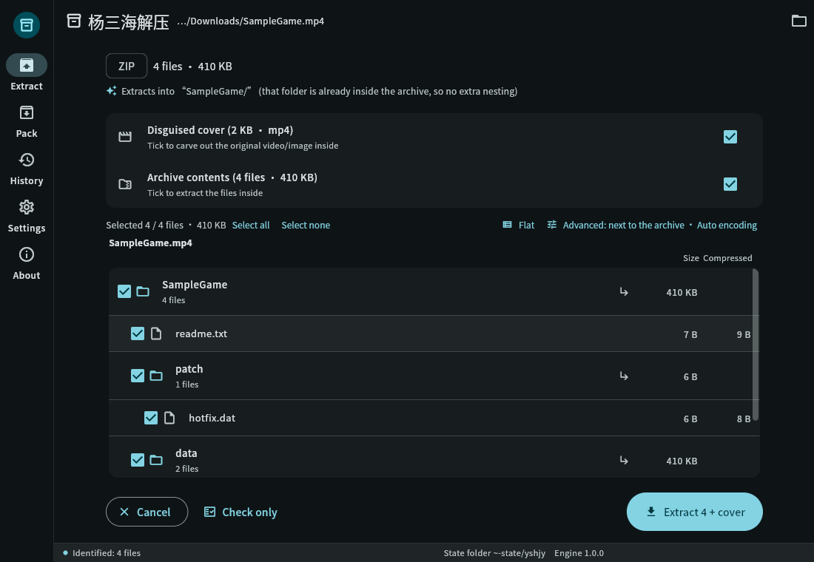
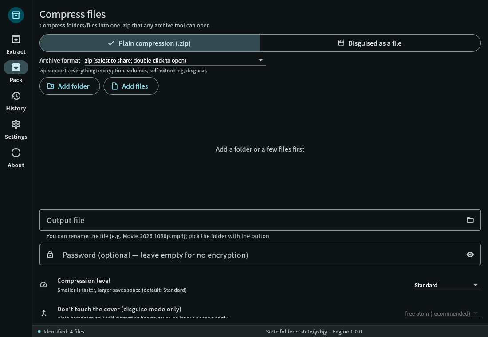
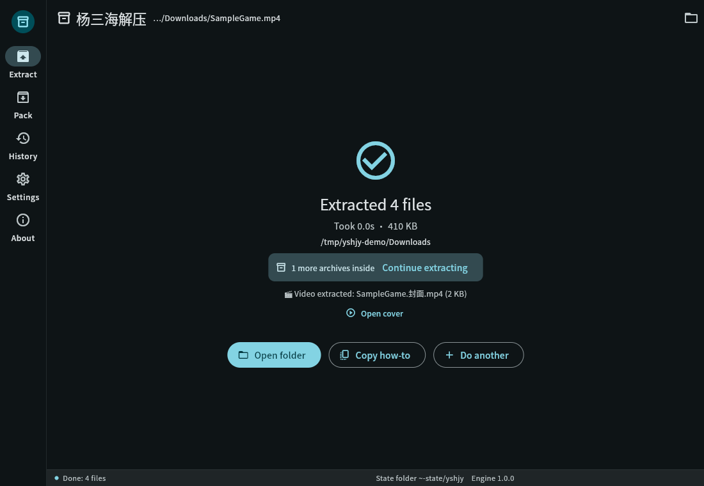
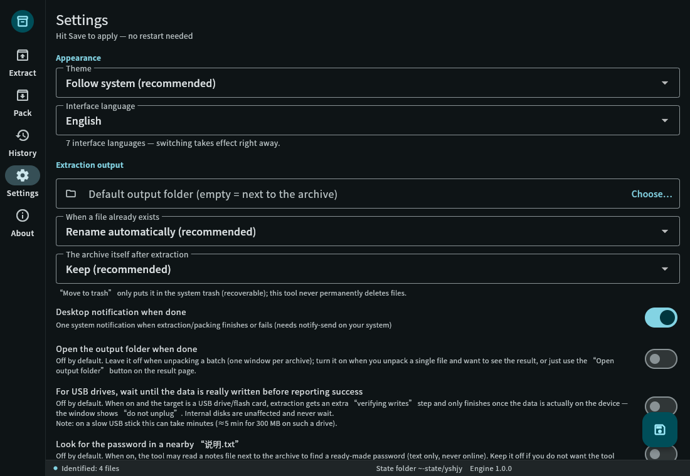
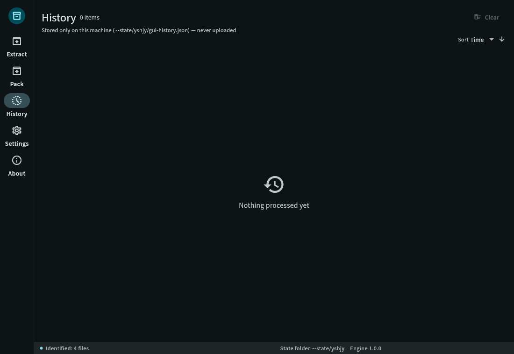
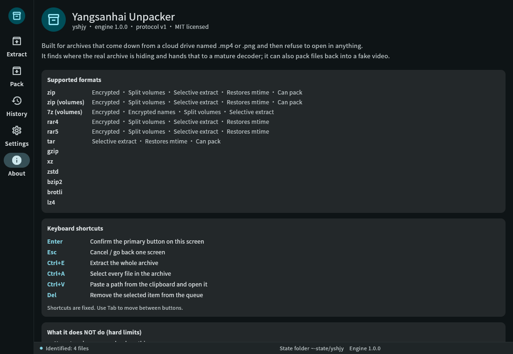

# yshjy — 楊三海解凍（ヤンサンハイかいとう）

> **ビデオ/写真に偽装されたアーカイブをワンステップで元のファイルに戻す。**
> クラウドドライブからダウンロードした「.mp4」ファイルで、どのツールでも開けないもの？そのままドラッグアンドドロップするだけ。

[简体中文](README.md) ｜ [繁體中文](README.zh-TW.md) ｜ [English](README.en.md) ｜ **日本語** ｜ [한국어](README.ko.md) ｜ [Русский](README.ru.md) ｜ [Español](README.es.md)

[](LICENSE)


<p align="center">
  
  
  
</p>

---

## 😵 なぜこのプロジェクトが存在するのか

リソースパックをダウンロードすると、.mp4ファイルの山と、次のようなreadmeが入っています：

> "パスワード: xxxx — すべてのMP4を.zipにリネームして、WinRARで展開してください"

それでやってみると：

- リネームしてダブルクリック → **「ファイルが破損しています」** ❌
- 7-Zipを試す、スマホの組み込み展開ツールを試す → **「アーカイブではありません」** ❌
- フォーラムで誰かが「#mode」と話題にする → **どこにも見つからない** ❌
- 再ダウンロードするか、あきらめる

理由は簡単です。これらの「ビデオ」は、アーカイブをMP4のシェルに詰め込んだものです（クラウドドライブのコンテンツスキャンをすり抜けるため）— そしてアーカイブ自身のディレクトリテーブルが**意図的に破損させられている**ため、すべての標準的な展開ツールが破損していると判断するのです。
**これらは壊れていません。壊れているように見せかけられているだけです。**

市販のすべての展開ツールは、通常のアーカイブを待っているだけです。誰も「壊れているように見える」タイプのアーカイブには対応していません。そこで、yshjyを作成しました：**リネーム不要、"#mode"不要、7-Zipも不要**。ファイルをドラッグアンドドロップするか、1つのコマンドを実行するだけです。

---

## ✨ 機能

**展開**

- 拡張子ではなくコンテンツでアーカイブを認識（`.mp4` / `.jpg` / `.pdf` などでもOK；1つのファイルに2つのアーカイブが含まれている場合も処理可能）
- **中国語のファイル名が文字化けしない** 、**中国語のパスワードも設定不要** （GBKエンコードのアーカイブもそのまま動作）
- 破損したディレクトリテーブルは、展開前に**メモリ内で修復** — **ディスク上のデータは1バイトも変更されません**
- マルチボリュームアーカイブは自動的に結合：7zボリューム、RARボリューム、ZIP `.z01/.z02…`、生分割 `.001/.002…`
- `--list` で展開前に中身を確認；必要な部分のみ展開可能
- 完了時に**保存先と内部にさらにアーカイブがあるかを通知** （ネストされたアーカイブも自動的に取り出される）
- ディレクトリテーブルが完全に消失している場合、**レスキューモード**で各ファイルのヘッダーからリストを再構築 — まだ救出できるものはすべて取り出される
- バッチモード：フォルダー全体をキューに追加、1つの不良ファイルが他を止めることはない

**パック（逆方向）**

- ファイルをビデオや画像に偽装（MP4は本物の`free`アトムレイアウト；他のコンテナはテール追加）
- 各パッケージは**読み戻して検証**され、完了と報告されるまで — 「見た目は問題なし、実際は壊れている」という結果は決して出ない
- オプション：ボリューム、パスワード、ダミーデータ、カバービデオ

**日常使用**

- 5ページのGUIと**7つのインターフェース言語** （简体中文 / 繁體中文 / English / 日本語 / 한국어 / Русский / Español）
- **両ページでドラッグアンドドロップに対応**：ホームページにドラッグアンドドロップで展開、パックページにドラッグアンドドロップでパック
- 7言語のCLI、スクリプト可能 (`--json` は1行に1イベントをストリーム出力)
- **完全オフライン**：プログラムにはネットワークコードが1行もない — 「アップロードしないと約束します」ではなく、単にアップロードする能力がない
- Linux .debはメニュー項目と14のファイルタイプのコンテキストメニュー項目を提供；Windowsインストーラーは22の拡張子とフォルダーのコンテキストメニューを登録
- 2つのビルド：**標準** （一般的なフォーマット、小さい、推奨）と**フル** （レアフォーマット用の余裕 — 現在のカバレッジは同一）

---

## 🖼 スクリーンショット

| プレビュー | パック | 設定 |
|---|---|---|
|  |  |  |

| 結果 | 履歴 | について |
|---|---|---|
|  |  |  |

中国語のスクリーンショットは `data/screenshots/` にあります。
言語を切り替えるには、**設定 → インターフェース言語** を選択；即座に適用され、再起動は不要です。

---

## ✅ コマンドラインを20秒で

```bash
# 展開 — これだけです
yshjy movie.mp4

# 展開せずに中身を確認
yshjy --list movie.mp4

# パスワード付き
yshjy -p "correct horse" game.mp4

# フォルダー全体をキューに追加（1つの失敗が他を止めることはない、大きいファイルから先に処理）
yshjy Downloads/games/

# アーカイブの一部のみ
yshjy --select "*.exe" game.mp4          # .exeファイルのみ
yshjy --select "data/**" game.mp4        # 1つのディレクトリのみ
yshjy --select required game.mp4         # .DS_Store などをスキップ

# 2つ同時に（デフォルトはシーケンシャル — ディスクに最も優しい）
yshjy --jobs 2 Downloads/games/

# 機械可読イベントストリーム
yshjy --json archive.mp4 | jq .

# 破損したアーカイブにレスキューを強制
yshjy --rescue broken.zip

# パック：ファイルをビデオに偽装
yshjy ys MyGame/
yshjy ys MyGame/ -p "password"           # 暗号化
yshjy ys MyGame/ --split 2G              # 2 GBボリューム

# 何かが開かない？診断バンドルを生成（イシューに添付可能）
yshjy --report archive.mp4
yshjy --report --no-paths archive.mp4    # パスを編集（公開投稿用）
```

**実ファイルを使用した測定結果：**

| ケース | 結果 |
|---|---|
| 8.7 GBの実在する偽装アーカイブ（8 GiBの内部ボリューム + 中国語パスワード） | **8,589,934,592バイト** 展開、SHA-256で手書きスクリプトと**バイト単位で完全一致** |
| 同じ8.7 GBファイルに対する `--list` | **0.09秒** （「zipクレートにオフセットを検出させる」バグ修正前は109秒） |
| フルリグレッション `bash tests/all.sh` | **62件成功 / 0件失敗 / 5件スキップ** |
| ユニット + UIテスト | Rust **448**件のユニットテスト成功；**440**件のFlutterテスト成功 |
| ファジング | 読み取り専用および書き込みパスターゲットを長時間実行、**クラッシュゼロ** |
| パック → 展開のラウンドトリップ | `diff -r` クリーン、セルフチェック成功 |

---

## 📦 どのファイルをダウンロードすればいい？

**Linux**

| ファイル | インストール | 適切な用途 |
|---|---|---|
| `yshjy_1.0.0_amd64.deb` | `sudo apt install ./yshjy_1.0.0_amd64.deb` | ほとんどのユーザー：メニュー項目 + コンテキストメニュー |
| `yshjy-1.0.0-linux-x86_64.tar.gz` （標準） | 展開して `yshjy` を `~/.local/bin/` に配置 | パッケージマネージャーなし、CLIのみ |
| `yshjy-full-1.0.0-linux-x66_64.tar.gz` （フル） | 上記と同じ | レアフォーマット用の余裕（現在のカバレッジは同一） |

**Windows**

| ファイル | 方法 | 適切な用途 |
|---|---|---|
| `yshjy-1.0.0-setup.exe` | ダブルクリック（ユーザーごとのインストール、UACプロンプトなし） | ほとんどのユーザー：22の拡張子 + フォルダーコンテキストメニュー |
| `yshjy-1.0.0-win-x64.zip` （ポータブル） | 任意の場所に展開して `yshjy_gui.exe` を実行 | インストール不要、USBメモリから実行可能 |
| `yshjy-1.0.0-win-x64-cli.zip` （CLI） | 展開してフォルダーをPATHに追加 | スクリプト、バッチジョブ |

> WindowsビルドにはVC++ランタイム (`msvcp140` / `vcruntime140` / `vcruntime140_1`) がバンドルされているため、クリーンなWindowsマシンでも事前インストールは不要です。
> 3つすべてに `SHA256SUMS.txt` が同梱されています。

---

## 📋 サポートされているフォーマット（正直なリスト）

| 分野 | サポート | 備考 |
|---|---|---|
| **展開** | ZIP （ZIP64含む）、7z、RAR （1.3 → 7）、TAR、GZIP、XZ、ZSTD、BZIP2、BROTLI、LZ4 | 空ファイル、ディレクトリ、シンボリックリンク、長いパスすべて対応 |
| **暗号化** | ZipCrypto、AES-256、7z AES-256 | ASCII以外のパスワードは設定なしで動作 |
| **ボリューム** | 7zボリューム、RARボリューム、ZIP `.z01/.z02…`、生分割 `.001/.002…` | 欠落したボリュームはその旨を報告、決して黙ってスキップしない |
| **偽装コンテナ** | 任意：MP4は本物の`free`アトムを使用、他はテール追加 | 画像やPDFもテスト済み |
| **レスキュー** | ZIPオフセット修復 + ローカルヘッダー再構築 + ZIP64エクストラ | 他のフォーマットはまだ |
| **パック** | ZIP / 7z （ボリューム、パスワード） | RARは生成不可（後述） |

> **オープンソース**の実装のみを使用。RARは展開のみ対応（RARの公式ライセンスではアーカイブの生成が禁止されているため）。
> コア機能は**外部プログラムに依存しない** — 7-Zip、WinRAR、unrarをインストールする必要はない。

> **唯一の例外は「MKV添付ファイル」レイアウト** (`--layout L8`)：システムに既にインストールされている **ffmpeg** ([ffmpeg.org](https://ffmpeg.org/), LGPL/GPLのフリーソフトウェア) を呼び出して、カバービデオをMKVにリマックスし、アーカイブを添付ファイルとして保存します。
> ffmpegをバンドル、変更、再配布することはありません — **ユーザーが** インストールした場合にのみ、1回呼び出されます。ffmpegなしではツールは `free`-アトムレイアウトにフォールバックし、その旨を通知します；
> 成功したように見せかけるために偽のMKVを書き込むことは決してありません。その他の機能はffmpegなしでも動作します。

---

## 🆚 通常の展開ツールとの比較

| 機能 | 一般的なツール | **yshjy** |
|---|---|---|
| コンテンツで識別、拡張子を無視 | 部分的 | ✅ |
| ファイルの途中や末尾に隠されたアーカイブを検出 | ✗ | ✅ （1つのファイルに複数のアーカイブが含まれている場合も） |
| ASCII以外のファイル名を読み込み可能 | ✗ （GBKアーカイブは常に文字化け） | ✅ 4段階のフォールバック（UTF-8フラグ → UTF-8 → GB18030 → 最後の手段） |
| ASCII以外のパスワードに設定不要 | ✗ （手動でエンコーディングを切り替え） | ✅ |
| 破損したディレクトリテーブルを修復 | ✗ | ✅ メモリ内で修復、ソースは変更されない |
| テーブルが回復不可能な場合のレスキューモード | ✗ | ✅ ファイルヘッダーからリストを再構築 |
| パック時に自分の出力を検証 | ✗ | ✅ 読み戻して明確に失敗を報告 |
| グラフィカルインターフェース | ✗ （ほとんどがCLI） | ✅ Linux + Windows、5ページ、7言語 |
| 完全オフライン | 時々 | ✅ ネットワークコードは一切なし |

**一言で言えば**：他のツールは「ファイルが破損しています」と表示します。このツールは**何が起こったか、なぜか、そしてまだ救出できる量**を教えてくれます。

---

## 🔧 ソースからビルド

```bash
# Rust 1.85+ （edition 2024）
git clone https://github.com/yangsanhai/yshjy
cd yshjy
cargo build --release
# 出力: target/release/yshjy （単一ファイル、~9 MB、外部依存なし）

install -Dm755 target/release/yshjy ~/.local/bin/yshjy   # CLIのみ

# GUI （Flutter 3.44+ が必要）
cd gui && flutter build linux --release && cd ..
bash scripts/build-deb.sh     # dist/ に .deb を生成
```

テスト：

```bash
cargo test                                   # 448件のユニットテスト
cargo clippy --all-targets -- -D warnings    # 静的チェック（警告ゼロ）
bash tests/all.sh                            # フルリグレッション、62項目、~5分
cd gui && flutter test                       # 440件のUIテスト
```

---

## 🌍 インターフェース言語（7言語）

简体中文 · 繁體中文 · English · 日本語 · 한국어 · Русский · Español

- **設定 → インターフェース言語** で切り替え；即座に適用されます
- CLI: `--lang en` （または `ja` / `ko` / `ru` / `es` / `zh-TW`）
- 自分の言語を追加する場合：`locales/` に `.toml` ファイルを、`gui/assets/l10n/` に `.json` ファイルを配置 — **コードの変更は不要**；欠落したキーは空白やtofuボックスを表示する代わりに英語にフォールバックします

---

## 💥 クラッシュした — どう報告すればいい？

1. `yshjy --report` を実行
   これにより、現在のディレクトリに `yshjy-report-<時刻>.zip` が作成され、最新のクラッシュレコード（`crash/` フォルダー：クラッシュした場所、バックトレース、コマンドライン — **パスワードは既に `<redacted>` に置き換えられています**）が含まれます
2. そのzipをイシューに添付

バンドルは不要？ログは `~/.local/state/yshjy/crash/` （Windows: `%LOCALAPPDATA%\yshjy\crash\`）にあります。

公開前に `yshjy --report --no-paths` を実行 — パスは `<home>` スタイルのプレイスホルダーに置き換えられ、ユーザー名は表示されません。

> 自動的にアップロードされることは一切ありません（プログラムにはネットワークコードが一切ないため）。
> 送信するかどうか、誰に送信するかは完全にユーザーの判断です。

---

## ❓ よくある質問

**Q: WinRAR / 7-Zipを使えばいいじゃない？**
A: これらは、ビデオの途中にあるアーカイブや、ディレクトリテーブルが破損したアーカイブを**見ることができません**。これは設計によるもので、バグではありません。WinRARはWindowsでは有料ソフトウェアであり、Linuxでは利用できません。

**Q: 暗号化されたアーカイブのパスワードを読み取れますか？**
A: いいえ — これは数学的に不可能であり、暗号化の目的そのものです。展開前に**何エントリがロックされているかを教えてくれる**ので、与えられたパスワードが正しいかを確認できます（途中で発見するのではなく）。

**Q: 「自動パスワード試行」とは具体的に何ですか？**
A: **既に持っている**暗号化アーカイブに対して、**ユーザーが記録した**パスワードを1つずつ試します（暗号化されたエントリの最初の数KBをチェックするだけで検証可能）。他のマシンにログインしたり、接続したりすることはできません — コンピューターに侵入するには、そのマシンにリモートエントリポイントが必要であり、これは展開ツールよりもはるかに上位の層です。

**Q: セキュリティリスクはありますか？**
A: 組み込みの防御機能：パス遍歴ブロッキング (`../../etc/passwd`)、ZIPボムガード（圧縮率と総サイズ）、実行ファイルが出てきた際の警告。しかし、正直に言いましょう：これらの「リネームして展開」パックはマルウェアの温床です。実行する前にスキャンしてください。

**Q: 完全な再生可能なビデオを取り出せますか？**
A: はい。`yshjy --extract-cover archive.mp4`、またはGUIで「偽装カバー」のみにチェックを入れる — カバーは既に完全なMP4であり、そのまま取り出されます。

**Q: ソースファイルを変更しますか？**
A: **絶対にしません**。すべての修復はメモリ内で行われます；ディスク上のファイルは1バイトも変更されません。

**Q: なぜRARを展開できるのにRARを作成できないのですか？**
A: RARの圧縮アルゴリズムは独自技術であり、そのライセンスでは展開のみが許可されています。このプロジェクトでは、オープンソースの実装のみを使用しています。

**Q: モバイルは？**
A: まだです。Android / iOS は未着手（このマシンにはSDK/NDKがなく、AppleのビルドにはMacが必要）。現在のリリース：LinuxとWindows。

---

## 🚫 このツールが意図的に行わないこと

これらは「まだではない」ではなく、**設計により範囲外**です。ユーザーと将来の貢献者がどこに線引きされているかを正確に知ってもらうために書き留めています。

- **辞書攻撃、総当り攻撃は行いません**。パスワード候補は正確に2つの場所から来ます：**ユーザーが記録した**パスフレーズと、パッカーが**アーカイブの横に公開した**パスフレーズ（readmeなど）。
- **組み込みの一般的なパスワードリストはありません**。これは小さな辞書を同梱することになります。古い「組み込みの一般的なパスワードを試す」スイッチは、偽のシェルしかなく、**削除されました**。
- **辞書ファイルオプションはなく、候補上限はハードリミットです**。`max_candidates` にはハード上限があり、設定で総当りツールに変えることはできません（テストで強制されています）。
- **ネットワーク、アップロードは行いません**。「アップロードしないと約束します」ではなく、プログラムには**ネットワークコードが一切ない**からです。
- **パスワードの収集は行いません**。readmeからスクレイプしたパスワードは**試して破棄**され、パスワードブックに書き込まれることはありません。そのブックはユーザーが編集するか、`--import-passwords` で入力するものです。
- **ファイルの変更は行いません**。すべての修復はメモリ内で行われます。

**真のリスクは、他の人が手渡すアーカイブです**。これらのパックはマルウェアの温床です。ツールは防御します（`../` 遍歴をブロック、ZIPボムを防止、実行ファイルに警告）が、**実行する前にスキャンしてください**。

また：**リバースパック** (`ys`) はファイルをビデオに偽装でき、その機能は騙すために使用される可能性があります。自分のバックアップと法的な共有にのみ使用してください（免責事項を参照）。

---

## 🛠 デザインと開発者向けドキュメント

- `DESIGN.md` — 製品デザイン（要件、機能、決定ログ）
- `docs/ARCHITECTURE.md` — アーキテクチャ
- `docs/INTERNALS.md` — **内部概要**：現在のコードの様子（モジュールの責任、依存関係、メカニズム、`scripts/scan-src.py` によって生成）
- `docs/TODO.md` — **完全性の唯一の情報源**
- `docs/CLI-SPEC.md` / `docs/UI-SPEC.md` — CLIとUIの仕様
- `docs/` の残り — フォーマットごとの測定と、途中で遭遇した落とし穴

貢献したい？[CONTRIBUTING.md](CONTRIBUTING.md) を参照してください。

---

## 💖 プロジェクトのサポート

- リポジトリにスターを付ける — できる最も役立つことで、無料です
- 失敗したパックについてイシューを開く：**`yshjy --report` バンドルを添付** — これが最も価値のある貢献です
- 寄付チャンネルはまだ設定されていません；設定され次第ここに掲載されます

---

## ⚖️ ライセンスと免責事項

[MIT](LICENSE) — 使用、修正、再配布（商用・非商用問わず）が可能です。唯一の要件は、著作権表示とライセンステキストを保持することです。

その帰属表示は2つの場所にあります：

1. すべてのソースファイルは `SPDX-License-Identifier: MIT` + `Copyright (c) 2026 yangsanhai` で始まります
2. バイナリにコンパイルされています：`yshjy --version` は帰属表示を印刷し、**非印刷の出所マーカー**が埋め込まれています。`strings` ダンプで `yshjy|MIT|Copyright (c) 2026 yangsanhai` が表示された場合、コードの出所が分かります（これはMITの帰属要件を満たす方法です — これは隠れたウォーターマークではなく、展開するファイルを**決して変更しません**）

サードパーティのオープンソースクレート：**190**のRust依存関係とFlutter / pubパッケージ、それぞれが独自のライセンス（MIT / Apache-2.0 / BSD-3-Clause / Zlib / Unicode-3.0 …）の下にあります。
完全なリストとライセンステキストは**アプリ内に同梱されています**：について → オープンソースライセンス。
リストは `Cargo.lock` から `scripts/gen-third-party.py` と `tests/all.sh` によって生成され、`tests/all.sh` が古くならないように検証します。したがって、常に実際にコンパイルされた内容と一致します。
**ネットワーク接続は一切不要です** — 製品の約束はオフラインであることです。

**免責事項**：**個人的なバックアップと法的な共有**にのみ使用してください。法律を回避したり、侵害コンテンツを配布するために使用しないでください。ユーザーはその使用に対する責任を負います。