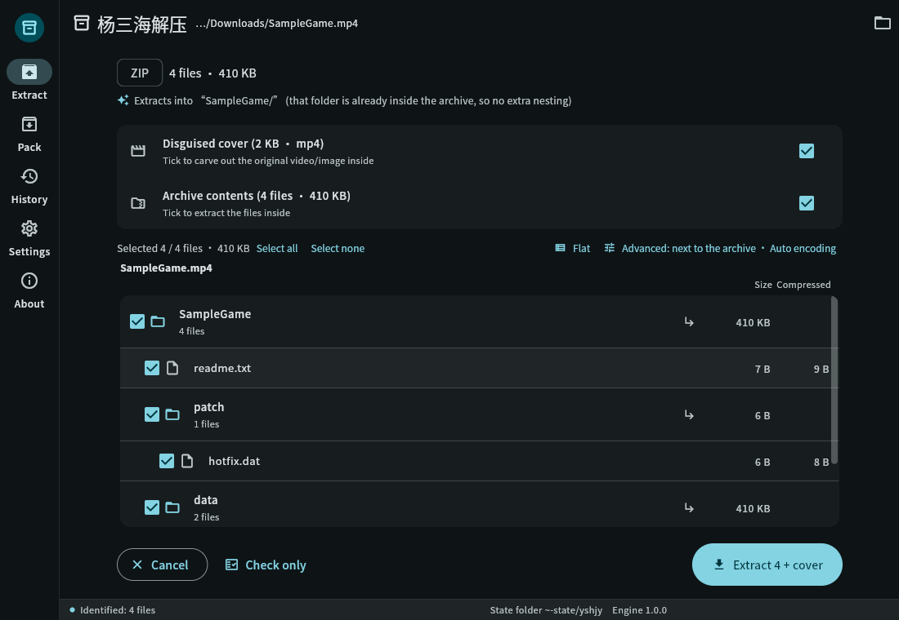
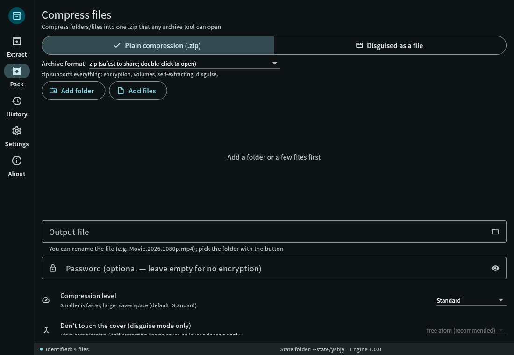
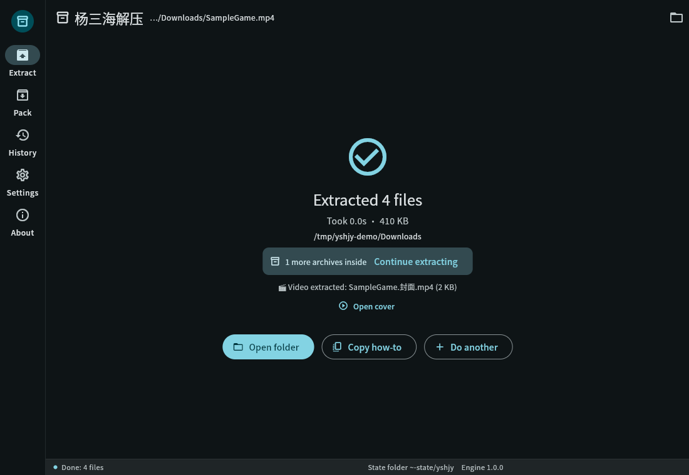
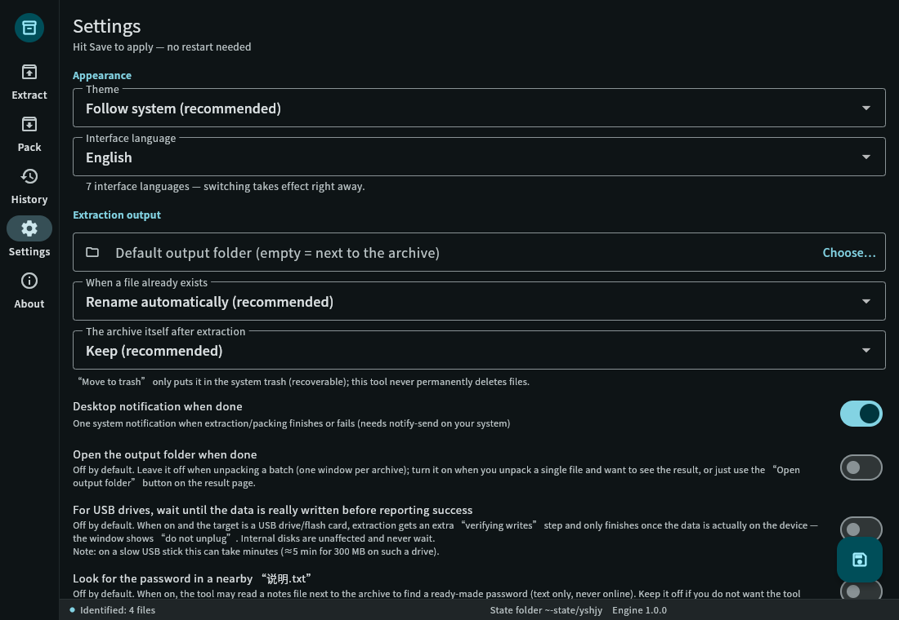
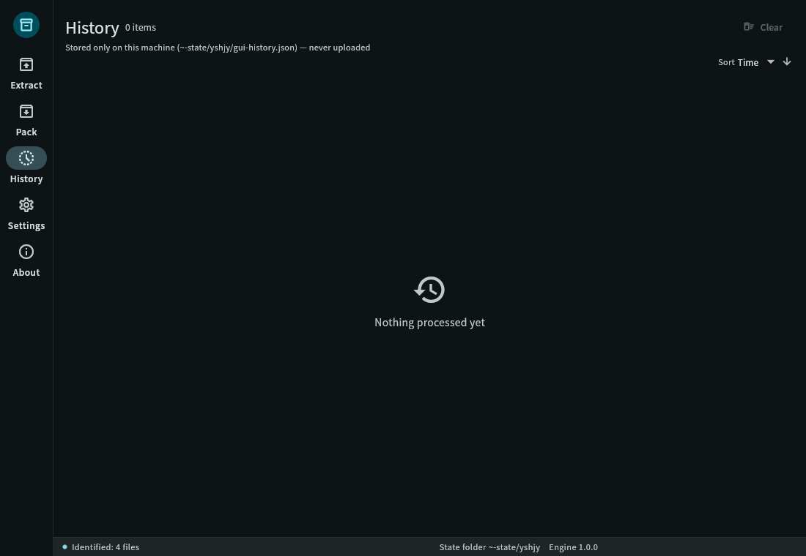
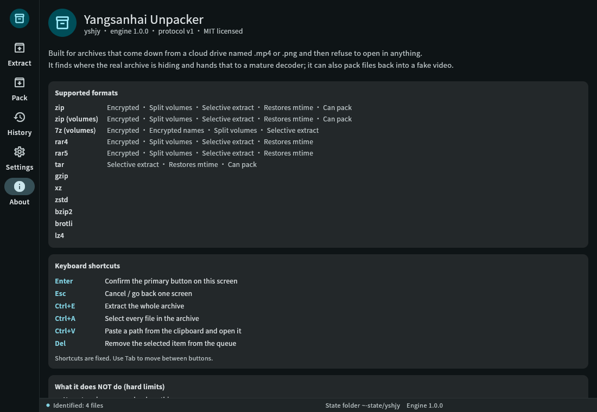

# yshjy — 양싼하이 압축 해제

> **비디오/사진으로 위장된 아카이브를 한 번에 실제 파일로 복원합니다.**
> 클라우드 드라이브에서 다운로드한 ".mp4" 파일로 어떤 도구도 열 수 없나요? 그냥 드래그 앤 드롭하세요.

[简体中文](README.md) ｜ [繁體中文](README.zh-TW.md) ｜ [English](README.en.md) ｜ [日本語](README.ja.md) ｜ **한국어** ｜ [Русский](README.ru.md) ｜ [Español](README.es.md)

[](LICENSE)


<p align="center">
  
  
  
</p>

---

## 😵 이 프로젝트가 만들어진 이유

리소스 팩을 다운로드받으면 `.mp4` 파일 더미와 함께 읽기 파일에서 다음과 같은 메시지를 보게 됩니다:

> "비밀번호: xxxx — 모든 MP4 파일을 .zip으로 이름 바꾸고 WinRAR로 추출하세요"

그래서 따라 해보지만:

- 이름 바꾸고 더블클릭 → **"파일이 손상되었습니다"** ❌
- 7-Zip 사용, 폰 기본 추출기 사용 → **"아카이브가 아닙니다"** ❌
- 포럼에서 누군가가 "#mode"를 언급 → **어디서도 찾을 수 없음** ❌
- 다시 다운로드하거나 포기

이유는 간단합니다. 해당 "비디오"는 클라우드 드라이브 콘텐츠 스캔을 우회하기 위해 도구로 MP4 쉘에 아카이브를 넣은 것입니다.
그리고 아카이브의 디렉터리 테이블이 **고의로 손상되어** 모든 표준 추출기가 손상되었다고 보고합니다.
**손상된 것이 아닙니다. 손상된 것처럼 보이도록 만든 것입니다.**

시중의 모든 추출기는 *정상적인* 아카이브를 기다립니다. "손상된 것처럼 보이는" 유형은 아무도 처리하지 않습니다.
그래서 yshjy를 만들었습니다: **이름 바꾸기 필요 없음, "#mode" 필요 없음, 7-Zip 필요 없음.**
파일을 드래그 앤 드롭하거나 한 명령어만 실행하세요.

---

## ✨ 기능

**추출**

- 확장자가 아닌 콘텐츠로 아카이브 인식 (`.mp4` / `.jpg` / `.pdf` 모두 가능;
  단일 파일에 두 개의 아카이브가 포함된 경우에도 처리)
- **중국어 파일 이름이 깨지지 않음**, **중국어 비밀번호는 설정 불필요**
  (GBK 인코딩 아카이브도 바로 사용 가능)
- 손상된 디렉터리 테이블이 있는 아카이브는 추출 전 **메모리에서 복구** —
  **디스크의 데이터는 한 바이트도 수정되지 않음**
- 다중 볼륨 아카이브는 자동으로 결합: 7z 볼륨, RAR 볼륨, ZIP `.z01/.z02…`,
  및 원시 분할 `.001/.002…`
- `--list`로 추출 전 내부를 미리 확인; 원하는 부분만 추출 가능
- 완료 시 **추출 위치와 중첩 아카이브 여부** 알려줌
  (중첩된 아카이브는 자동으로 추출)
- 디렉터리 테이블이 완전히 사라진 경우 **구조 모드**로 각 파일 헤더에서 목록 재구축 —
  복구 가능한 모든 내용 추출
- 배치 모드: 폴더 전체를 큐에 넣으면 하나의 잘못된 파일로 인해 나머지 작업이 중단되지 않음

**패키지 (역방향)**

- 파일을 비디오 또는 이미지로 위장 (MP4는 실제 `free` atom 레이아웃; 다른 컨테이너는 꼬리 추가)
- 모든 패키지는 **완료 보고 전 읽기 및 검증** — "보이는 것은 좋지만 실제로는 손상된" 결과는 절대 발생하지 않음
- 선택적 볼륨, 비밀번호, 더미 데이터, 커버 비디오

**일상 사용**

- 5개의 페이지와 **7개의 인터페이스 언어** (简体中文 / 繁體中文 / English / 日本語 /
  한국어 / Русский / Español) 지원 GUI
- **모든 페이지에서 드래그 앤 드롭 지원**: 홈 페이지에 드래그하여 추출, 패키지 페이지에 드래그하여 패키지
- 동일한 7개 언어로 제공되는 CLI, 스크립트 가능 (`--json`은 한 줄에 하나의 이벤트 스트림)
- **완전히 오프라인**: 프로그램에 네트워킹 코드가 한 줄도 없음 —
  "업로드하지 않겠습니다"가 아니라 단순히 업로드 기능이 없음
- Linux .deb는 메뉴 항목과 14개의 파일 유형 컨텍스트 메뉴 항목 제공; Windows 설치 프로그램은 22개의 확장자 및 폴더 컨텍스트 메뉴 등록
- 두 가지 빌드: **표준** (일상 포맷, 작음, 추천) 및 **완전**
  (드문 포맷을 위한 여유 공간 — 현재 커버리지는 동일)

---

## 🖼 스크린샷

| 미리보기 | 패키지 | 설정 |
|---|---|---|
|  |  |  |

| 결과 | 기록 | 정보 |
|---|---|---|
|  |  |  |

중국어 스크린샷은 `data/screenshots/`에 있습니다.
**설정 → 인터페이스 언어**에서 언어를 전환하면 즉시 적용됩니다. 재시작 불필요.

---

## ✅ 20초 만에 명령어 사용

```bash
# 추출 — 이게 전부입니다
yshjy movie.mp4

# 추출하지 않고 내부 미리 보기
yshjy --list movie.mp4

# 비밀번호가 있는 경우
yshjy -p "correct horse" game.mp4

# 폴더 전체 큐에 넣기 (하나의 실패로 인해 나머지 작업 중단되지 않음, 큰 파일 먼저)
yshjy Downloads/games/

# 아카이브의 일부만 추출
yshjy --select "*.exe" game.mp4          # .exe 파일만
yshjy --select "data/**" game.mp4        # 특정 디렉터리만
yshjy --select required game.mp4         # .DS_Store 등 제외

# 동시에 두 개씩 처리 (기본은 순차적 — 디스크에 가장 부담이 적음)
yshjy --jobs 2 Downloads/games/

# 기계가 읽을 수 있는 이벤트 스트림
yshjy --json archive.mp4 | jq .

# 손상된 아카이브에서 구조 모드 강제 실행
yshjy --rescue broken.zip

# 패키지: 파일을 비디오로 위장
yshjy ys MyGame/
yshjy ys MyGame/ -p "password"           # 암호화
yshjy ys MyGame/ --split 2G              # 2GB 볼륨

# 어떤 파일이 열리지 않나요? 문제 진단 번들을 생성하여 이슈에 첨부
yshjy --report archive.mp4
yshjy --report --no-paths archive.mp4    # 경로 제거 (공개 게시물에 사용)
```

**실제 파일로 측정된 결과:**

| 경우 | 결과 |
|---|---|
| 8.7 GB 실제 위장 아카이브 (8 GiB 내부 볼륨 + 중국어 비밀번호) | **8,589,934,592 바이트** 추출, SHA-256으로 수동 스크립트와 **바이트 단위 동일** |
| 동일한 8.7 GB 파일에서 `--list` 실행 | **0.09 s** ("zip crate가 오프셋을 감지하도록 허용" 버그 수정 전에는 109초) |
| 전체 회귀 테스트 `bash tests/all.sh` | **62 통과 / 0 실패 / 5 건너뛰기** |
| 유닛 + UI 테스트 | Rust **448**개 유닛 테스트 통과; **440**개 Flutter 테스트 통과 |
| 퍼징 | 읽기 전용 및 쓰기 경로 대상 장기 실행, **충돌 없음** |
| 패키지 → 추출 왕복 테스트 | `diff -r` 깨끗, 자체 검사 통과 |

---

## 📦 어떤 파일을 다운로드해야 하나요?

**Linux**

| 파일 | 설치 | 적합한 사용자 |
|---|---|---|
| `yshjy_1.0.0_amd64.deb` | `sudo apt install ./yshjy_1.0.0_amd64.deb` | 대부분의 사용자: 메뉴 항목 + 컨텍스트 메뉴 |
| `yshjy-1.0.0-linux-x86_64.tar.gz` (표준) | 압축 해제 후 `yshjy`를 `~/.local/bin/`에 배치 | 패키지 관리자 없음, CLI만 사용 |
| `yshjy-full-1.0.0-linux-x86_64.tar.gz` (완전) | 동일 | 드문 포맷을 위한 여유 공간 (현재 커버리지는 동일) |

**Windows**

| 파일 | 방법 | 적합한 사용자 |
|---|---|---|
| `yshjy-1.0.0-setup.exe` | 더블클릭 (사용자별 설치, UAC 프롬프트 없음) | 대부분의 사용자: 22개 확장자 + 폴더 컨텍스트 메뉴 |
| `yshjy-1.0.0-win-x64.zip` (이동식) | 아무 데나 압축 해제 후 `yshjy_gui.exe` 실행 | 설치 불필요, USB에서 실행 가능 |
| `yshjy-1.0.0-win-x64-cli.zip` (CLI) | 압축 해제 후 폴더를 PATH에 추가 | 스크립트, 배치 작업 |

> Windows 빌드에는 VC++ 런타임 (`msvcp140` / `vcruntime140` / `vcruntime140_1`)이 번들로 제공되어
> 깨끗한 Windows 시스템에서도 사전 설치가 필요 없습니다.
> 세 가지 모두 `SHA256SUMS.txt`와 함께 제공됩니다.

---

## 📋 포맷 지원 (정직한 목록)

| 영역 | 지원 | 비고 |
|---|---|---|
| **추출** | ZIP (ZIP64 포함), 7z, RAR (1.3 → 7), TAR, GZIP, XZ, ZSTD, BZIP2, BROTLI, LZ4 | 빈 파일, 디렉터리, 심볼릭 링크, 긴 경로 모두 처리 |
| **암호화** | ZipCrypto, AES-256, 7z AES-256 | 비ASCII 비밀번호는 설정 없이 작동 |
| **볼륨** | 7z 볼륨, RAR 볼륨, ZIP `.z01/.z02…`, 원시 분할 `.001/.002…` | 누락된 볼륨은 보고됨, 절대 silently 건너뛰지 않음 |
| **위장 컨테이너** | 모든 유형: MP4는 실제 `free` atom 사용, 기타는 꼬리 추가 | 이미지 및 PDF도 테스트됨 |
| **구조** | ZIP 오프셋 복구 + 로컬 헤더 재구축 + ZIP64 추가 | 기타 포맷은 아직 미지원 |
| **패키지** | ZIP / 7z (볼륨, 비밀번호) | RAR는 생성하지 않음 (아래 참조) |

> **오픈 소스** 구현만 사용합니다. RAR는 추출만 지원합니다 (RAR의 공식 라이선스에서 아카이브 생성 금지).
> 핵심 기능은 **외부 프로그램 의존성 없음** — 7-Zip, WinRAR 또는 unrar 설치 불필요.

> **단일 예외는 "MKV 첨부 파일" 레이아웃** (`--layout L8`)입니다: 시스템에 이미 설치된 **ffmpeg**
> ([ffmpeg.org](https://ffmpeg.org/), LGPL/GPL 무료 소프트웨어)을 호출하여 커버 비디오를 MKV로 재multiplexing하고
> 아카이브를 첨부 파일로 저장합니다.
> ffmpeg을 번들로 제공, 수정 또는 재배포하지 않습니다 — **사용자가** 설치한 경우에만 한 번 호출됩니다.
> ffmpeg 없이도 도구는 `free`-atom 레이아웃으로 fallback하며 이를 알립니다;
> 성공한 것처럼 보이기 위해 가짜 MKV를 작성하지는 않습니다. 기타 모든 기능은 ffmpeg 없이 작동합니다.

---

## 🆚 일반 추출기와 비교

| 기능 | 일반적인 도구 | **yshjy** |
|---|---|---|
| 콘텐츠로 식별, 확장자 무시 | 부분 지원 | ✅ |
| 파일 중간 또는 끝에 숨겨진 아카이브 찾기 | ✗ | ✅ (하나의 파일에 여러 아카이브 포함) |
| 비ASCII 파일 이름이 읽기 가능 | ✗ (GBK 아카이브는 항상 깨짐) | ✅ 4단계 fallback (UTF-8 플래그 → UTF-8 → GB18030 → 마지막 수단) |
| 비ASCII 비밀번호, 설정 불필요 | ✗ (수동 인코딩 전환 필요) | ✅ |
| 손상된 디렉터리 테이블 복구 | ✗ | ✅ 메모리에서 복구, 원본은 손상되지 않음 |
| 테이블이 복구 불가능한 경우 구조 모드 | ✗ | ✅ 파일 헤더에서 목록 재구축 |
| 패키지 시 자체 출력 검증 | ✗ | ✅ 읽기 후 실패 시 큰 소리로 알림 |
| 그래픽 인터페이스 | ✗ (거의 모두 CLI) | ✅ Linux + Windows, 5개 페이지, 7개 언어 |
| 완전히 오프라인 | 때때로 | ✅ 네트워킹 코드 전혀 없음 |

**한 줄 요약:** 다른 도구는 "파일이 손상되었습니다"라고 말합니다. 이 도구는 **무엇이 발생했는지, 왜 발생했는지, 그리고 얼마나 많은 것이 아직 복구 가능한지** 알려줍니다.

---

## 🔧 소스에서 빌드

```bash
# Rust 1.85+ (edition 2024)
git clone https://github.com/yangsanhai/yshjy
cd yshjy
cargo build --release
# 출력: target/release/yshjy (단일 파일, ~9 MB, 외부 의존성 없음)

install -Dm755 target/release/yshjy ~/.local/bin/yshjy   # CLI만

# GUI (Flutter 3.44+ 필요)
cd gui && flutter build linux --release && cd ..
bash scripts/build-deb.sh     # dist/ 아래에 .deb 생성
```

테스트:

```bash
cargo test                                   # 448개 유닛 테스트
cargo clippy --all-targets -- -D warnings    # 정적 검사 (경고 없음)
bash tests/all.sh                            # 전체 회귀 테스트, 62개 항목, ~5분
cd gui && flutter test                       # 440개 UI 테스트
```

---

## 🌍 인터페이스 언어 (7개)

简体中文 · 繁體中文 · English · 日本語 · 한국어 · Русский · Español

- **설정 → 인터페이스 언어**에서 전환; 즉시 적용
- CLI: `--lang en` (또는 `ja` / `ko` / `ru` / `es` / `zh-TW`)
- 자신의 언어를 추가하려면 `locales/`에 `.toml` 파일을 추가하고
  `gui/assets/l10n/`에 `.json` 파일을 추가하세요 — **코드 변경 불필요**;
  누락된 키는 빈 칸 또는 tofu 상자 대신 영어로 fallback

---

## 💥 충돌 발생 — 어떻게 보고하나요?

1. `yshjy --report` 실행
   현재 디렉터리에 `yshjy-report-<시간>.zip`이 작성됩니다. 가장 최근 충돌 기록이 포함됩니다
   (`crash/` 폴더: 충돌 위치, 백트레이스, 명령어 — **비밀번호는 이미 `<redacted>`로 가려짐**)
2. 해당 zip 파일을 이슈에 첨부

번들이 필요하지 않나요? 로그는 `~/.local/state/yshjy/crash/`에 있습니다
(Windows: `%LOCALAPPDATA%\yshjy\crash\`).

공개 게시 전 `yshjy --report --no-paths`를 실행하세요 — 경로가 `<home>` 스타일
플레이스홀더로 대체됩니다.

> 자동으로 업로드되는 것은 없습니다 (프로그램에 네트워킹 코드가 전혀 없음).
> 보내고, 누구에게 보낼지는 전적으로 사용자의 선택입니다.

---

## ❓ 자주 묻는 질문

**Q: WinRAR / 7-Zip을 사용하지 않고 왜 이 도구를 사용해야 하나요?**
A: 비디오 중간 또는 디렉터리 테이블이 손상된 아카이브는 볼 수 없습니다. 이는 설계상 한계이지 버그가 아닙니다.
WinRAR은 또한 Windows에서 유료 소프트웨어이며 Linux에서는 사용할 수 없습니다.

**Q: 암호화된 아카이브의 비밀번호를 읽을 수 있나요?**
A: 아니요 — 수학적으로 불가능하며, 이는 암호화의 본질입니다. 추출 전 **얼마나 많은 항목이 잠겨 있는지** 알려줄 수 있습니다.
이렇게 하면 제공받은 비밀번호가 올바른지 확인할 수 있습니다.

**Q: "자동 비밀번호 시도"가 실제로 하는 일은 무엇인가요?**
A: **이미 보유한** 암호화된 아카이브에서 **사용자가 기록한** 비밀번호를 하나씩 시도합니다
(암호화된 항목의 처음 몇 KB를 확인하는 것만으로도 검증 가능).
어디에도 로그인할 수 없으며 다른 기기에는 접근할 수 없습니다 —
컴퓨터 해킹은 해당 기기의 원격 진입 점수가 필요하며, 이는 추출기보다 여러 계층 위입니다.

**Q: 보안 위험은 없나요?**
A: 내장된 방어 메커니즘: 경로 순회 차단 (`../../etc/passwd`), zip 폭탄 방어
(압축 비율 및 총 크기), 실행 파일 추출 시 경고. 하지만 솔직히 말해서:
이 "이름 바꾸기 및 추출" 팩은 악성 코드 온상입니다. 실행 전 스캔하세요.

**Q: 완전한 재생 가능한 비디오를 제공할 수 있나요?**
A: 예. `yshjy --extract-cover archive.mp4` 또는 GUI에서 "위장 커버"만 체크 —
커버는 이미 완전한 MP4이므로 그대로 추출됩니다.

**Q: 소스 파일을 수정하나요?**
A: **절대 수정하지 않습니다.** 모든 복구는 메모리에서 수행됩니다. 디스크의 파일은 바이트 단위까지도 수정되지 않습니다.

**Q: RAR는 추출만 하고 왜 생성하지 않나요?**
A: RAR의 압축 알고리즘은 독점적이며 라이선스에서 추출만 허용합니다.
이 프로젝트는 오픈 소스 구현만 사용합니다.

**Q: 모바일 지원은요?**
A: 아직 없습니다. Android / iOS는 시작하지 않았습니다 (이 기기에는 SDK/NDK가 없으며 Apple 빌드는 Mac이 필요).
현재 릴리스: Linux 및 Windows.

---

## 🚫 이 도구가 의도적으로 하지 않는 일

이것들은 "아직 아닌" 것이 아니라 **설계상 범위에서 제외**된 사항입니다.
사용자와 미래 기여자가 어디가 경계인지 명확히 알 수 있도록 작성되었습니다.

- **사전 공격, 무차별 대입 공격 없음.** 비밀번호 후보는 정확히 두 곳에서 옵니다: **사용자가 기록한** 암호구 및 **팩 생성자가 아카이브 옆에 게시한** 암호구.
- **내장된 일반 비밀번호 목록 없음.** 이는 작은 사전을 제공하는 것입니다.
  과거 "내장된 일반 비밀번호 시도" 스위치는 실제 연결이 없는 가짜 쉘이었으며 **제거되었습니다.**
- **사전 파일 옵션 없음, 후보 제한은 하드 코딩.** `max_candidates`에는 하드 한도가 있습니다;
  어떤 설정도 이를 무차별 대입 도구로 만들 수 없습니다 (테스트에서 강제 적용).
- **네트워크 없음, 업로드 없음.** "업로드하지 않겠습니다"가 아니라 **프로그램에 네트워킹 코드가 전혀 없습니다.**
- **비밀번호 수집 없음.** 읽기 파일에서 스크래핑한 비밀번호는 **시도 후 폐기**되며,
  사용자의 비밀번호 책에 절대 기록되지 않습니다. 해당 책은 사용자가 편집하거나 `--import-passwords`로 채울 수 있습니다.
- **파일 수정 없음.** 모든 복구는 메모리에서 수행됩니다.

**실제 위험은 다른 사람들이 건네는 아카이브입니다.** 이러한 팩은 악성 코드 온상입니다.
도구는 방어합니다 ( `../` 순회 차단, zip 폭탄 방어, 실행 파일 경고),
**하지만 실행 전 스캔하세요.**

또한: **역 패키지** (`ys`)는 파일을 비디오로 위장할 수 있으며, 이 기능은 속이기 위해 사용할 수 있습니다.
오직 자신의 백업 및 합법적인 공유에만 사용하세요 (면책 조항 참조).

---

## 🛠 설계 및 개발자 문서

- `DESIGN.md` — 제품 설계 (요구 사항, 기능, 결정 로그)
- `docs/ARCHITECTURE.md` — 아키텍처
- `docs/INTERNALS.md` — **내부 개요**: 오늘날 코드가 어떤 모습인지 (모듈 책임, 의존성, 메커니즘, `scripts/scan-src.py`에서 생성)
- `docs/TODO.md` — **완료를 위한 단일 진실 공원**
- `docs/CLI-SPEC.md` / `docs/UI-SPEC.md` — CLI 및 UI 사양
- 나머지 `docs/` — 포맷별 측정 및 과정 중 발생한 함정

기여하고 싶으신가요? [CONTRIBUTING.md](CONTRIBUTING.md)를 참조하세요.

---

## 💖 프로젝트 지원

- 저장소에 별표를 추가하세요 — 할 수 있는 가장 유용한 일이며 무료입니다.
- 실패한 팩에 대한 이슈 열기: **`yshjy --report` 번들을 첨부**하세요 — 이것이 가장 가치 있는 기여입니다.
- 기부 채널은 아직 설정되지 않았습니다. 설정되면 여기에 게시됩니다.

---

## ⚖️ 라이선스 및 면책 조항

이 프로젝트는 [MIT 라이선스](LICENSE)로 배포됩니다. 자유롭게 사용·수정·재배포할 수 있으며 상업적 이용도 가능합니다. 유일한 조건은 저작권 표시와 라이선스 전문을 유지하는 것입니다(`LICENSE` 및 각 소스 파일 상단 참고).

함께 포함된 서드파티 라이브러리는 각자의 라이선스를 따릅니다. 전체 목록과 라이선스 전문은 앱의 정보 → 오픈소스 라이선스에 들어 있습니다. 네트워크 연결은 필요하지 않습니다.

**면책**: 개인 백업과 합법적인 공유를 위한 도구입니다. 법령을 회피하거나 권리를 침해하는 내용을 배포하는 데 사용하지 마세요. 사용 결과에 대한 책임은 사용자에게 있습니다.
