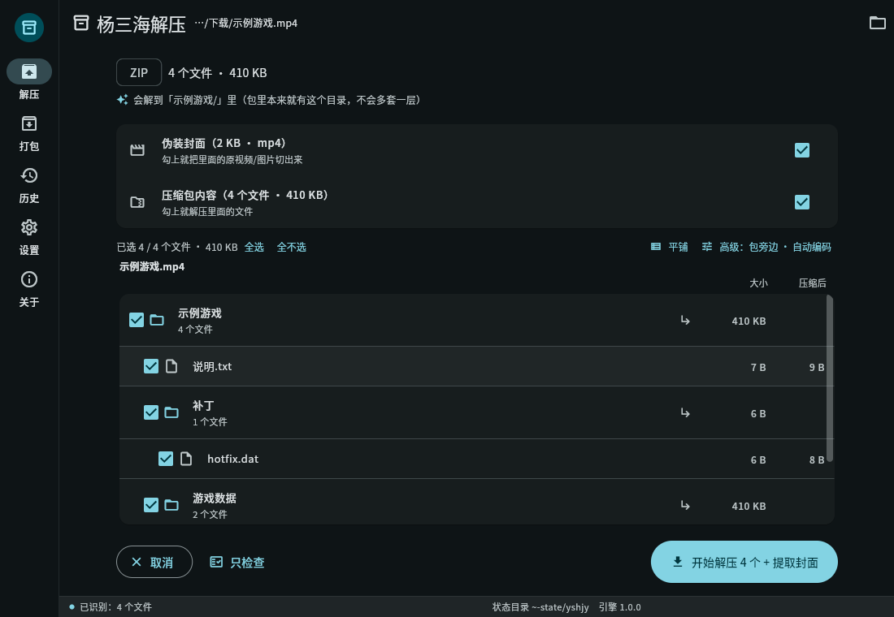
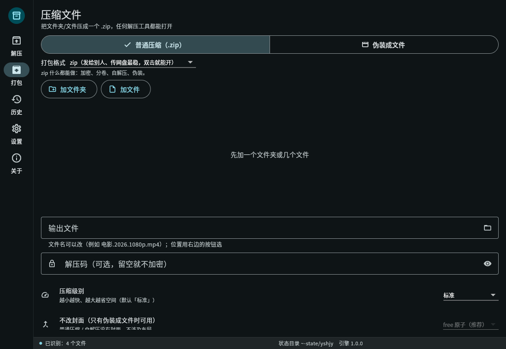
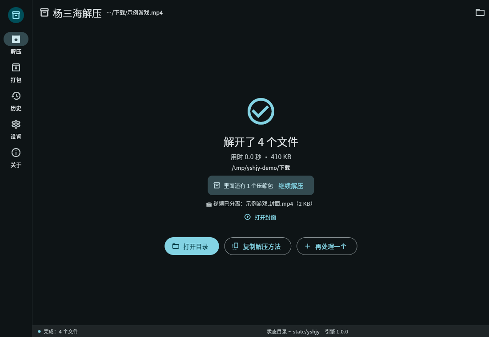
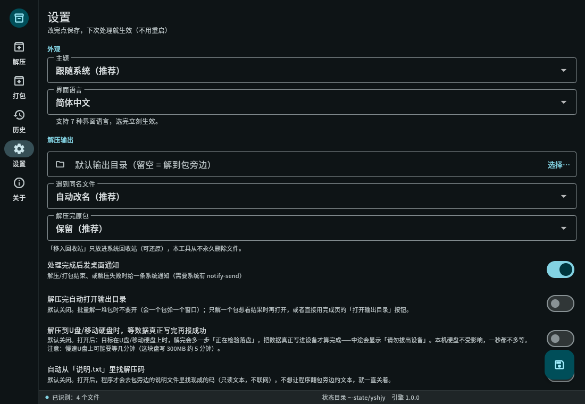
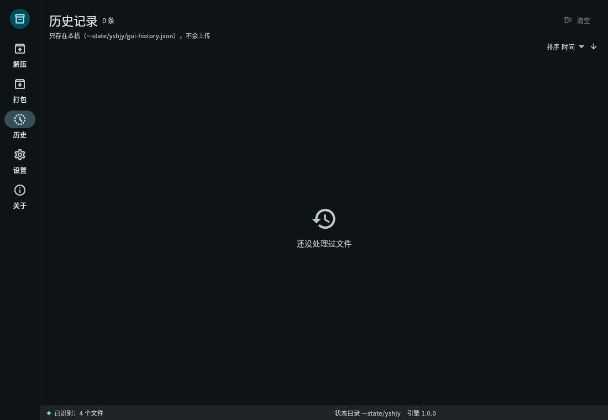
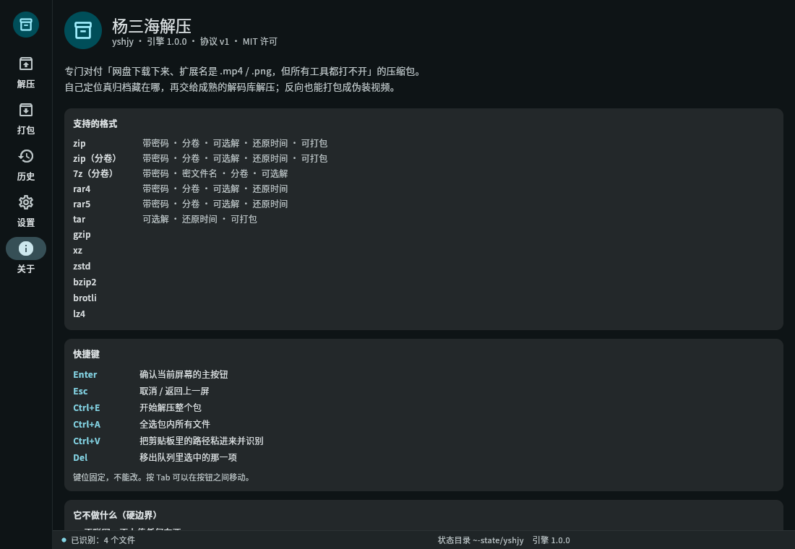

# 杨三海解压 (yshjy)

> **把「伪装成视频/图片的压缩包」一键还原成能用的文件。**
> 网盘里那些改了后缀也解不开的"视频"—— 拖进来就行。

**简体中文** ｜ [繁體中文](README.zh-TW.md) ｜ [English](README.en.md) ｜ [日本語](README.ja.md) ｜ [한국어](README.ko.md) ｜ [Русский](README.ru.md) ｜ [Español](README.es.md)

[](LICENSE)


<p align="center">
  
  
  
</p>

---

## 😵 为什么要做这个项目

在网上下了份资源，里面是一堆 `.mp4`，旁边一个说明文件写着：

> 「解压码：xxxx　把所有 MP4 后缀改成 .zip　然后用 WinRAR 解压」

你照做了，然后：

- 改完后缀双击 → **「文件损坏」** ❌
- 换 7-Zip、换手机自带解压 → **「不是压缩包」** ❌
- 论坛里有人说要「#号模式」→ **找不到在哪** ❌
- 最后只能重下，或者干脆放弃

原因其实不复杂：这些"视频"是用工具把压缩包塞进 MP4 外壳里做出来的（为了躲网盘审核），
而且里面压缩包的目录表还被**故意改过** —— 所以标准解压工具一律判定"文件损坏"。
**它们不是坏了，是被人为弄成"看起来坏了"。**

市面上的解压工具都在等一个"正常"的压缩包，没人管这种"看起来坏的"。
所以我写了 yshjy：**不用改后缀、不用找"#号模式"、不用装 7-Zip**，
把文件拖进来，或者一行命令，就完事。

---

## ✨ 我做了哪些功能

**解压**

- 不看后缀也认得出是压缩包（`.mp4` / `.jpg` / `.pdf` 都行；一个文件里藏了两个包也能都找出来）
- **中文文件名不乱码**、**中文解压码不用配置**（GBK 编码的包一样解）
- 索引被改坏的包，先在内存里修好再解 —— **磁盘上的源文件一个字节都不动**
- 分卷自动拼：7z 分卷、RAR 分卷、ZIP 的 `.z01/.z02…` 系列、按大小裸切的 `.001/.002…`
- 解之前先看看里面有什么（`--list`），能只挑一部分解
- 解完告诉你**解到哪、里面还有没有别的包**（嵌套的会顺手扒出来）
- 目录表彻底扫不出来时还有**救援模式**：按每个文件的头重建清单，能救多少救多少
- 批量处理：整个目录排队解，一个坏了不影响其余

**打包（反过来用）**

- 把文件伪装成视频/图片（MP4 走 free 原子布局，其它格式自动改尾部追加）
- 打出来先自己回读自检，不合格当场告诉你 —— 不给你一个"看着成功其实坏"的包
- 可以分卷、可以设密码、可以撒干扰数据、可以带封面视频

**用起来**

- 图形界面 5 个页面 + **7 种界面语言**（简体中文 / 繁體中文 / English / 日本語 / 한국어 / Русский / Español）
- **两页都能拖**：首页拖进来解压，打包页拖进来打包
- 命令行同样 7 语言、可脚本化（`--json` 按行输出事件流）
- **完全离线**：整个程序没有一行网络代码 —— 不是"承诺不上传"，是它压根没这个能力
- Linux 装机版带菜单项和 14 种格式的右键菜单；Windows 安装包带 22 个扩展名 + 文件夹右键菜单
- 两档版本：**常用版**（日常格式，体积小，推荐）和**全能版**（给冷门格式预留，当前覆盖一致）

---

## 🖼 界面长什么样

| 预览识别 | 打包 | 设置 |
|---|---|---|
|  |  |  |

| 解完的结果 | 历史 | 关于 |
|---|---|---|
|  |  |  |

英文界面在 `data/screenshots/en-US/`（繁體中文用简体截图；日/韩/俄/西用英文截图）。
界面语言在「设置 → 界面语言」切换，**改完立刻生效**，不用重启。

---

## ✅ 怎么用（命令行）

```bash
# 解压（最简单，就这一行）
yshjy 示例视频.mp4

# 先看看里面有什么，不解压
yshjy --list 电影.mp4

# 带解压码
yshjy -p "demo-password" 游戏.mp4

# 整个目录排队解（一个坏了不影响其余，大的先跑）
yshjy 下载/游戏合集/

# 只要里面的一部分
yshjy --select "*.exe" 游戏.mp4          # 只要 exe
yshjy --select "游戏数据/**" 游戏.mp4     # 只要某个目录
yshjy --select required 游戏.mp4         # 跳过 .DS_Store 之类垃圾

# 并行跑 2 个（默认按顺序来，最省磁盘）
yshjy --jobs 2 下载/游戏合集/

# 给脚本/前端消费（按行输出事件流）
yshjy --json 包.mp4 | jq .

# 文件索引坏了也尽量救
yshjy --rescue 坏掉的.zip

# 打包（把文件伪装成视频）
yshjy ys 我的游戏/
yshjy ys 我的游戏/ -p "解压码"            # 带密码
yshjy ys 我的游戏/ --split 2G             # 分成 2G 一块

# 解不开？生成一份诊断包（一个能直接贴到 issue 的 zip）
yshjy --report 包.mp4
yshjy --report --no-paths 包.mp4         # 路径脱敏（要贴到公开地方就用它）
```

**实测数据**（真文件，不是演示数据）：

| 场景 | 结果 |
|---|---|
| 8.7 GB 真实伪装包（内层 8 GiB 分卷 + 中文解压码） | 解出 **8,589,934,592 字节**，SHA-256 与手工脚本**逐字节一致** |
| `--list` 同一个 8.7 GB 包 | **0.09 秒**（修掉"让 zip 库自己检测偏移"那个坑之前是 109 秒） |
| 全部回归 `bash tests/all.sh` | **62 通过 / 0 失败 / 5 跳过** |
| 单元测试 + 界面测试 | Rust **448** 个单测全过；界面 **440** 条测试全过 |
| 模糊测试 | 只读入口与写盘入口长期跑，**零崩溃** |
| 打包 → 解压闭环 | 产物 `diff -r` 完全一致，自检通过 |

---

## 📦 装哪个

**Linux**

| 文件 | 怎么装 | 适合谁 |
|---|---|---|
| `yshjy_1.0.0_amd64.deb` | `sudo apt install ./yshjy_1.0.0_amd64.deb` | 大多数人：能从菜单启动、有右键菜单 |
| `yshjy-1.0.0-linux-x86_64.tar.gz`（常用版） | 解出来，把 `yshjy` 丢进 `~/.local/bin/` | 不想装包、只要命令行 |
| `yshjy-full-1.0.0-linux-x86_64.tar.gz`（全能版） | 同上 | 给冷门格式预留（当前与常用版覆盖一致） |

**Windows**

| 文件 | 怎么用 | 适合谁 |
|---|---|---|
| `yshjy-1.0.0-setup.exe` | 双击安装（按用户安装，不弹 UAC） | 大多数人：装完有 22 个扩展名 + 文件夹右键菜单 |
| `yshjy-1.0.0-win-x64.zip`（绿色版） | 解压到任意目录，双击 `yshjy_gui.exe` | 不想装、要放 U 盘带走 |
| `yshjy-1.0.0-win-x64-cli.zip`（命令行版） | 解压后把目录加进 PATH | 脚本、批量处理 |

> Windows 包已带 VC++ 运行库（`msvcp140` / `vcruntime140` / `vcruntime140_1`），
> 干净的 Windows 机器不用先装运行库。
> 三个包都附 `SHA256SUMS.txt`，下载后可以自己核对。

---

## 📋 格式支持（诚实清单）

| 类别 | 已支持 | 说明 |
|---|---|---|
| **解压** | ZIP（含 ZIP64）、7z、RAR（1.3 → 7）、TAR、GZIP、XZ、ZSTD、BZIP2、BROTLI、LZ4 | 空文件、目录、符号链接、长路径都处理 |
| **加密** | ZipCrypto、AES-256、7z AES-256 | 中文密码免配置 |
| **分卷** | 7z 分卷、RAR 分卷、ZIP 的 `.z01/.z02…`、裸切分 `.001/.002…` | 缺卷会明确报「分卷不齐」 |
| **伪装外壳** | 任意类型：MP4 走 free 原子，其它自动改尾部追加 | 伪装成图片、PDF 也实测可行 |
| **救援** | ZIP 的 offset 修复 + local header 重建 + ZIP64 extra | 其它格式暂不支持 |
| **打包** | ZIP / 7z（含分卷、密码） | 不生成 RAR（见下） |

> 只使用**开源**技术实现：RAR 仅支持解压（不生成），符合 RAR 官方许可限制。
> 核心功能**零外部程序依赖** —— 不需要你装 7-Zip / WinRAR / unrar。
>
> **唯一的例外是「MKV 附件」布局**（`--layout L8`）：它借系统里的 **ffmpeg**
> （[ffmpeg.org](https://ffmpeg.org/)，LGPL/GPL 自由软件）把封面视频**重封装**成 MKV，
> 再把压缩包作为「附件」塞进去。我们不打包、不修改、不替它分发 —— 只在你**自己装了**
> ffmpeg 的时候调用一次命令行；**没装就自动退回 `free` 原子布局**并在结果里说明，
> 绝不会为了「看起来成功」写出一个假的 MKV。其余所有功能都不需要 ffmpeg。

---

## 🆚 和别的解压工具比

| 能力 | 常见工具 | **yshjy** |
|---|---|---|
| 不看后缀，自动认格式 | 部分支持 | ✅ |
| 认出藏在文件中间/末尾的包 | ✗ | ✅（还能找出一个文件里的多个包） |
| 中文文件名不乱码 | ✗（GBK 包必乱码） | ✅ 四级回退（UTF-8 标志 → UTF-8 → GB18030 → 兜底） |
| 中文解压密码免配置 | ✗（要手动改编码） | ✅ |
| 索引坏了能自动修 | ✗ | ✅ 只改内存，不动源文件 |
| 救援模式（扫不出目录表也救） | ✗ | ✅ 按每个文件的头重建清单 |
| 打包时自检产物 | ✗ | ✅ 回读自检，不合格就报警 |
| 有图形界面 | ✗（同类几乎都是命令行） | ✅ Linux + Windows，5 页，7 种语言 |
| 完全离线 | 部分 | ✅ 没有一行网络代码 |

**一句话**：别人只会说"文件损坏"，这个工具会告诉你**发生了什么、为什么、还能救多少**。

---

## 🔧 从源码编译

```bash
# 需要 Rust 1.85+（edition 2024）
git clone https://github.com/yangsanhai/yshjy
cd yshjy
cargo build --release
# 产物：target/release/yshjy（单文件，约 9 MB，零外部依赖）

# 装到用户目录（只要命令行）
install -Dm755 target/release/yshjy ~/.local/bin/yshjy

# 想要图形界面（需要 Flutter 3.44+）
cd gui && flutter build linux --release && cd ..
bash scripts/build-deb.sh     # 打成 deb，产物在 dist/
```

跑测试：

```bash
cargo test                                   # 448 个单测
cargo clippy --all-targets -- -D warnings    # 静态检查（零警告）
bash tests/all.sh                            # 全部回归（62 项，约 5 分钟）
cd gui && flutter test                       # 界面 440 条
```

---

## 🌍 界面语言（7 种）

简体中文 · 繁體中文 · English · 日本語 · 한국어 · Русский · Español

- 界面语言在「设置 → 界面语言」里切换，**改完立刻生效**，不用重启
- 命令行语言用 `--lang en`（或 `ja` / `ko` / `ru` / `es` / `zh-TW`）
- 想加自己母语？往 `locales/` 丢一个 `.toml`、往 `gui/assets/l10n/` 丢一个 `.json` 就行，
  **不用改一行代码**；缺的键会自动退回英文，不会冒出空白或方块

---

## 💥 崩了怎么办（报障只要两步）

1. 跑一次 `yshjy --report`
   会在当前目录生成 `yshjy-report-<时间>.zip` —— **里面自动带上最近一次崩溃记录**
   （`crash/` 目录：崩在哪一行、调用栈、当时的命令行，密码已抹成 `<已抹掉>`）
2. 把这个 zip 发给我（issue / 邮箱 / 群里都行）

不想生成包也可以：崩溃日志就在 `~/.local/state/yshjy/crash/`
（Windows：`%LOCALAPPDATA%\yshjy\crash\`），最新那份就是。

要贴到公开论坛之前，先跑 `yshjy --report --no-paths`：
里面的路径会换成 `<home>` 这类占位符，不会再带你的用户名。

> 它**不会自动上传**任何东西（这个程序根本不联网）。发不发、发给谁，都由你决定。

---

## ❓ 常见问题

**Q：为什么不用 WinRAR / 7-Zip 解？**
A：它们**看不见**藏在视频中间、或者索引被改坏的压缩包 —— 这是它们的设计，不是 bug。
而且 WinRAR 是 Windows 收费软件，Linux、手机上没有。

**Q：加密包的密码能"读"出来吗？**
A：不能，数学上不可能（加密的意义就在这）。但能在**解压前告诉你有几个文件带锁**，
让你先确认手里的解压码对不对，省得解到一半才发现错。

**Q：那"自动试密码"到底在做什么？**
A：只在你手上那份**已经拿到的**加密包上，用你自己记过的密码挨个试一下
（每次只读加密条目的开头几 KB 就能判对错）。它**不能登录任何东西、不能连别人的电脑** ——
要入侵一台计算机，得对方机器上有能被远程连进来的入口，解压工具够不着那一层。

**Q：会不会有安全风险？**
A：内置防护：防路径穿越（`../../etc/passwd` 这类）、防解压炸弹（压缩比 + 总量双闸）、
解出可执行文件会提醒你。但**提醒**：这类"改后缀解压"的资源是恶意软件重灾区，运行前建议扫毒。

**Q：能解出打开就播放的完整视频吗？**
A：能。用 `yshjy --extract-cover 包.mp4`，或界面预览页只勾「伪装封面」——
封面视频本来就是完整的 MP4，原样剥出来。

**Q：它会改我的源文件吗？**
A：**绝不**。所有修复都在内存里做，磁盘上的源文件一个字节都不动。

**Q：为什么只能解 RAR，不能打 RAR？**
A：RAR 的压缩算法是专有的，官方许可只允许"解"不允许"生成"。只用开源实现，不碰这条线。

**Q：手机上能用吗？**
A：还没有。Android / iOS 都未开始（这台机器上没有 SDK/NDK，也没法编苹果的包）。
装机版目前是 Linux + Windows。

---

## 🚫 这个工具刻意不做的事

下面这些不是"暂时没做"，是**明确不做** —— 写在这里，是为了让用户、也让以后改代码的人都知道边界在哪。

- **不做字典攻击、不做暴力破解。** 密码候选只有两个来源：**你自己记的密码本**、
  以及**包作者公开写在包旁边的说明文件**。都是"你已知"或"公开"的信息。
- **不内置常见密码表。** 那等于自带一个小字典。以前有过一个"尝试内置常见解压码"的开关，
  它从来没接线过（等于骗人的空壳），**已删除**。
- **不提供"字典文件"参数，候选数也夹死了。** `max_candidates` 有硬上限，
  配置改不出"爆破模式"（这条有测试守着）。
- **不联网、不上传任何东西。** 整个程序**没有一行网络代码** —— 不是"我们承诺不传"，
  是它压根没有这个能力。
- **不自动收集密码。** 从说明文件里抓到的密码**只试不存**：用完就丢，绝不写进你的密码本。
  密码本只能你自己编辑，或你主动跑 `--import-passwords` 导入。
- **不改你的文件。** 所有修复（修坏索引）都在内存里做，磁盘上的源文件一个字节都不动。

**反过来，真正要小心的是"别人给你的包"：** 这类"改后缀解压"的资源是恶意软件重灾区。
程序有防护（拦 `../` 路径穿越、防解压炸弹、解出可执行文件会提醒），但**运行前请自己扫毒**。

另外提醒一句：**反向打包**（`ys` 命令）能把文件伪装成视频 —— 这功能本身可被用来骗人。
请只用于自己的备份与合法分享（见文末免责声明）。

---

## 🛠 开发与设计文档

- `DESIGN.md` — 产品设计（需求、功能、决策记录）
- `docs/ARCHITECTURE.md` — 架构设计
- `docs/INTERNALS.md` — **内部全景**：代码现在长什么样（模块职责/依赖/机制/落点，由 `scripts/scan-src.py` 扫源码生成）
- `docs/TODO.md` — 完成度的**唯一真源**
- `docs/CLI-SPEC.md` / `docs/UI-SPEC.md` — 命令行规范与界面文案表
- `docs/` 下其余文档 — 各格式的实测记录与踩过的坑

想参与？看 [CONTRIBUTING.md](CONTRIBUTING.md)。

---

## 💖 支持这个项目

- 在 GitHub 上点个 ⭐ —— 最实在，不要钱
- 提 issue 说哪个包没解开：**带上 `yshjy --report` 生成的诊断包最有用**，这是最有价值的贡献
- 赞赏渠道暂未开通，开了会补在这里

---

## ⚖️ 许可与免责

本项目采用 [MIT 许可证](LICENSE) —— 你可以自由使用、修改、再分发（包括商用），
唯一要求是**保留版权声明和许可证原文**。

这份署名在两处：

1. 每个源文件头：`SPDX-License-Identifier: MIT` + `Copyright (c) 2026 yangsanhai`
2. 编译进二进制：`yshjy --version` 末尾会打印署名；另外程序里有一段**不打印的溯源标记**，
   任何人用 `strings` 在别处见到 `yshjy|MIT|Copyright (c) 2026 yangsanhai` 就知道它来自这里
   （这是 MIT 要求保留署名的落地方式 —— 不是偷偷埋水印，也**不改你解出来的任何文件**）

用到的第三方开源库一共 **190 个**（Rust 依赖）加 Flutter / pub 包那一半，各自仍归各自的许可证
（MIT / Apache-2.0 / BSD-3-Clause / Zlib / Unicode-3.0 等）。完整清单和许可证文本**就装在软件里**：
「关于」页 → 「开源许可」。清单由 `scripts/gen-third-party.py` 从 `Cargo.lock` 自动生成
（`tests/all.sh` 会核对它有没有过期），所以它跟实际编译用的依赖永远一致。
**看这些内容不需要联网** —— 软件整体对外的承诺就是完全离线。

**免责声明**：本工具仅供**个人备份与合法分享**使用。请勿用于规避法律法规或分发侵权内容。
使用者应自行承担因使用本工具产生的一切后果。
