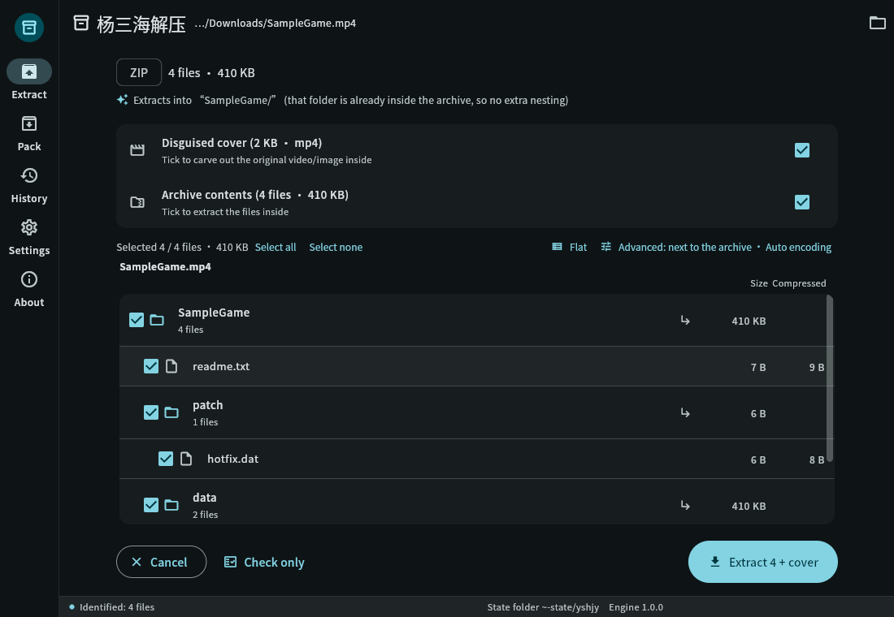
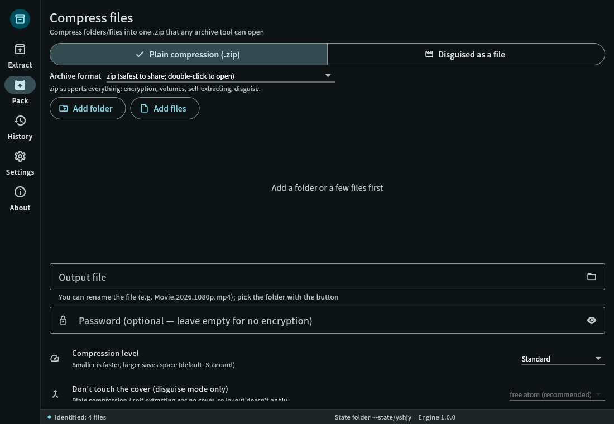
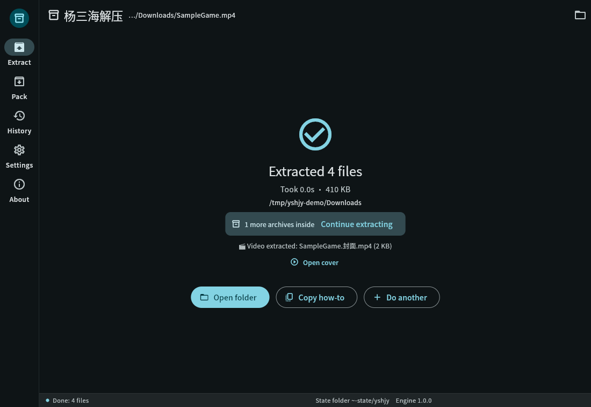
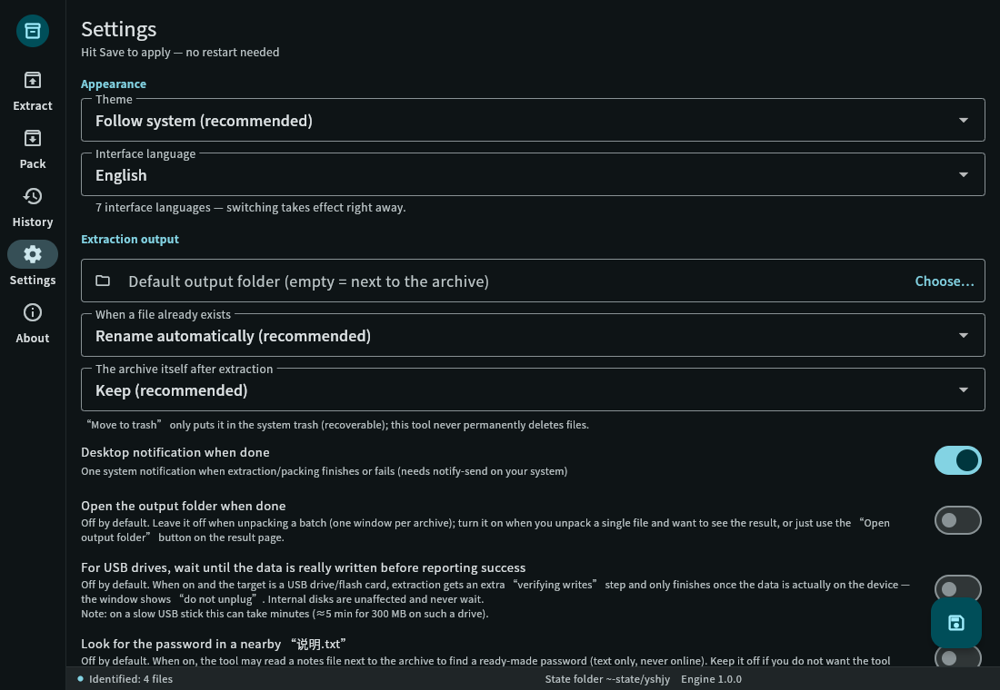
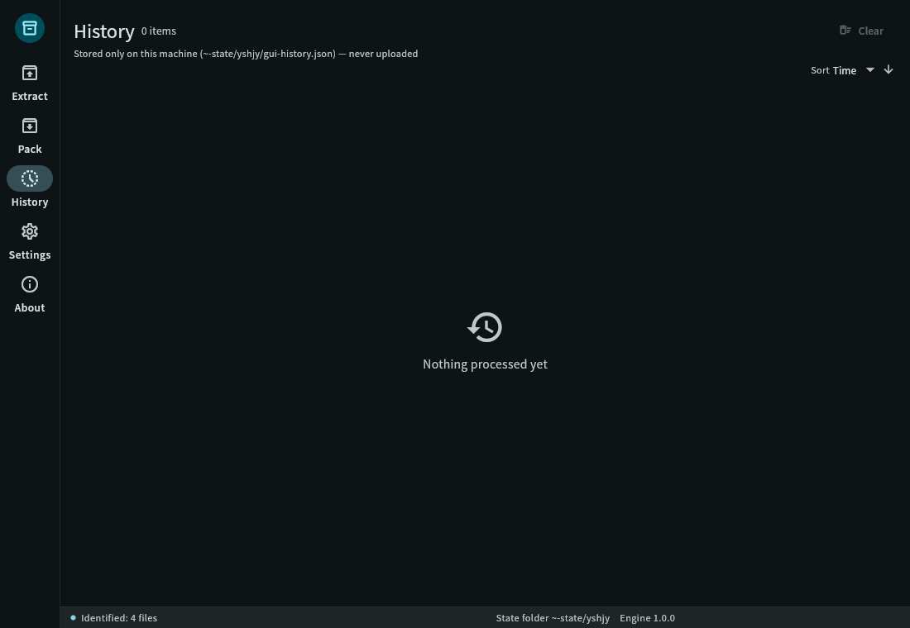
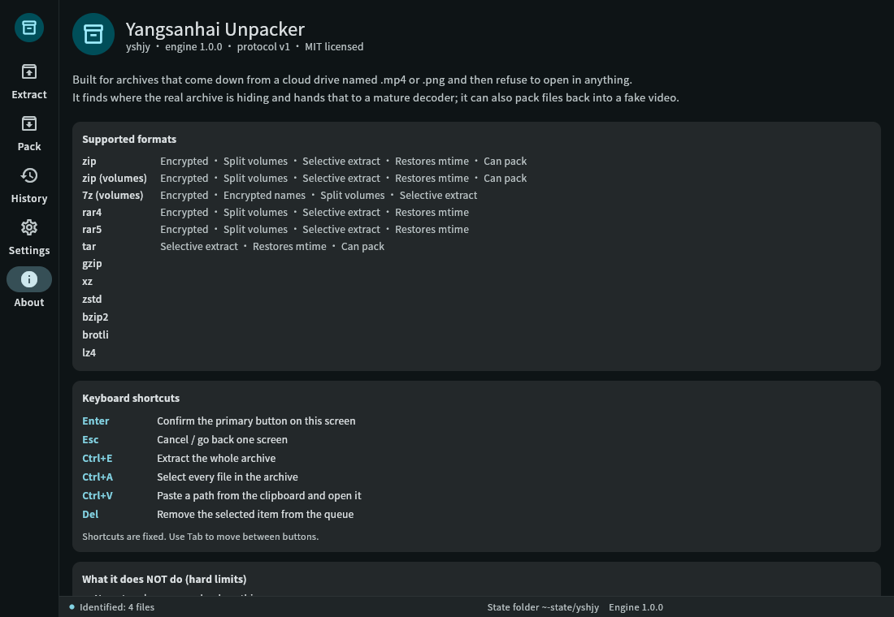

# yshjy — распаковщик «Ян Саньхай»

> **Превратите архив, замаскированный под видео/фото, обратно в реальные файлы за один шаг.**
> Те «.mp4»-файлы из облачных дисков, которые не открывает ни один инструмент? Просто перетащите их сюда.

[简体中文](README.md) ｜ [繁體中文](README.zh-TW.md) ｜ [English](README.en.md) ｜ [日本語](README.ja.md) ｜ [한국어](README.ko.md) ｜ **Русский** ｜ [Español](README.es.md)

[](LICENSE)


<p align="center">
  
  
  
</p>

---

## 😵 Почему этот проект нужен

Вы скачиваете пак ресурсов, а там куча файлов `.mp4` плюс readme с инструкцией:

> «Пароль: xxxx — переименуйте каждый MP4 в .zip и распакуйте через WinRAR»

Вы так и делаете, но:

- Переименовали, дважды кликнули → **«Файл повреждён»** ❌
- Попробовали 7-Zip, встроенный в телефон архиватор → **«Это не архив»** ❌
- Кто-то на форуме упоминает «#mode» → **нигде не можете найти** ❌
- Перекачиваете заново или сдаётесь

Причина простая. Эти «видео» — архивы, упакованные в оболочку MP4 специальным инструментом
(чтобы обойти сканирование содержимого облачными сервисами), и **таблица каталогов архива
специально повреждена**, поэтому любой стандартный архиватор объявляет его битым.
**Они не сломаны. Их специально сделали «сломанными».**

Все существующие архиваторы ждут *нормальный* архив; никто не обрабатывает «выглядит сломанным».
Поэтому я написал yshjy: **не нужно переименовывать, не нужно «#mode», не нужен 7-Zip.**
Просто перетащите файл или выполните одну команду.

---

## ✨ Что он умеет

**Распаковка**

- Распознаёт архив по содержимому, а не по расширению (`.mp4` / `.jpg` / `.pdf` — всё подходит;
  один файл с двумя архивами внутри тоже обрабатывается)
- **Китайские имена файлов не превращаются в кракозябры**, а **китайские пароли не требуют настройки**
  (архивы в кодировке GBK работают «из коробки»)
- Архивы с повреждённой таблицей каталогов восстанавливаются **в памяти** перед извлечением —
  **ни один байт на диске не изменяется**
- Многотомные архивы объединяются автоматически: тома 7z, тома RAR, ZIP `.z01/.z02…`,
  а также сырые части `.001/.002…`
- `--list` показывает содержимое перед извлечением; можно извлечь только нужные части
- По завершении сообщает **куда извлеклось и есть ли внутри другие архивы**
  (вложенные извлекаются автоматически)
- Если таблица каталогов полностью утеряна, **режим восстановления** восстанавливает список из заголовков
  каждого файла — вы получите всё, что ещё можно спасти
- Пакетный режим: можно добавить в очередь целую папку, один битый файл не остановит остальные

**Упаковка (обратное действие)**

- Маскирует файлы под видео или изображение (MP4 получает реальную структуру `free` atom; остальные
  контейнеры — добавление в конец)
- Каждый пакет **проверяется чтением** перед тем, как будет объявлен готовым — вы никогда не получите
  результат «выглядит нормально, но на самом деле сломан»
- Опционально: тома, пароль, отвлекающие данные, обложка видео

**Повседневное использование**

- GUI с 5 страницами и **7 языками интерфейса** (简体中文 / 繁體中文 / English / 日本語 /
  한국어 / Русский / Español)
- **Обе страницы поддерживают перетаскивание**: перетащите на главную страницу для распаковки,
  на страницу упаковки — для упаковки
- CLI на тех же 7 языках, скриптуемый (`--json` выводит одно событие на строку)
- **Полностью офлайн**: в программе нет ни одной строки сетевого кода —
  это не «мы обещаем не загружать», а просто отсутствие такой возможности
- В Linux .deb устанавливает пункт в меню и 14 контекстных меню для типов файлов; в Windows установщик
  регистрирует 22 расширения плюс контекстное меню для папок
- Две сборки: **стандартная** (обычные форматы, небольшая, рекомендуемая) и **полная**
  (запас для редких форматов — покрытие идентично на сегодня)

---

## 🖼 Скриншоты

| Предпросмотр | Упаковка | Настройки |
|---|---|---|
|  |  |  |

| Результат | История | О программе |
|---|---|---|
|  |  |  |

Скриншоты на китайском находятся в `data/screenshots/`.
Изменить язык можно в **Настройки → Язык интерфейса**; применяется сразу, без перезапуска.

---

## ✅ Командная строка за 20 секунд

```bash
# Распаковка — это всё, что нужно
yshjy movie.mp4

# Посмотреть содержимое без извлечения
yshjy --list movie.mp4

# С паролем
yshjy -p "correct horse" game.mp4

# Обработать целую папку (одна ошибка не останавливает остальные, сначала большие)
yshjy Downloads/games/

# Только часть архива
yshjy --select "*.exe" game.mp4          # только .exe файлы
yshjy --select "data/**" game.mp4        # только одна директория
yshjy --select required game.mp4         # пропустить .DS_Store и подобные

# Две задачи одновременно (по умолчанию последовательно — максимально бережно к диску)
yshjy --jobs 2 Downloads/games/

# Поток событий в машиночитаемом формате
yshjy --json archive.mp4 | jq .

# Принудительный режим восстановления для повреждённого архива
yshjy --rescue broken.zip

# Упаковка: замаскировать файлы под видео
yshjy ys MyGame/
yshjy ys MyGame/ -p "password"           # с шифрованием
yshjy ys MyGame/ --split 2G              # тома по 2 ГБ

# Что-то не открывается? Создайте диагностический пакет для баг-репорта
yshjy --report archive.mp4
yshjy --report --no-paths archive.mp4    # пути заменены (используйте для публичных постов)
```

**Измерено на реальных файлах, а не на демо-данных:**

| Сценарий | Результат |
|---|---|
| 8,7 ГБ реального замаскированного архива (8 GiB внутренних томов + китайский пароль) | извлечено **8,589,934,592 байт**, SHA-256 **полностью совпадает** с ручным скриптом |
| `--list` на том же файле 8,7 ГБ | **0,09 с** (109 с до исправления бага «пусть zip-библиотека определяет смещение») |
| Полный регрессионный тест `bash tests/all.sh` | **62 пройдено / 0 ошибок / 5 пропущено** |
| Юнит- и UI-тесты | Rust: **448** юнит-тестов зелёные; **440** Flutter-тестов зелёные |
| Фуззинг | цели только для чтения и записи работают долго, **ноль крахов** |
| Цикл упаковка → распаковка | `diff -r` чистый, самопроверка пройдена |

---

## 📦 Какой файл скачивать?

**Linux**

| Файл | Установка | Для кого |
|---|---|---|
| `yshjy_1.0.0_amd64.deb` | `sudo apt install ./yshjy_1.0.0_amd64.deb` | Большинству: пункт в меню + контекстное меню |
| `yshjy-1.0.0-linux-x86_64.tar.gz` (стандартная) | распаковать, положить `yshjy` в `~/.local/bin/` | Без пакетного менеджера, только CLI |
| `yshjy-full-1.0.0-linux-x86_64.tar.gz` (полная) | то же | Запас для редких форматов (покрытие идентично на сегодня) |

**Windows**

| Файл | Как | Для кого |
|---|---|---|
| `yshjy-1.0.0-setup.exe` | двойной клик (установка для пользователя, без запроса UAC) | Большинству: 22 расширения + контекстное меню папок |
| `yshjy-1.0.0-win-x64.zip` (портативная) | распаковать куда угодно, запустить `yshjy_gui.exe` | Без установки, работает с флешки |
| `yshjy-1.0.0-win-x64-cli.zip` (CLI) | распаковать, добавить папку в PATH | Скрипты, пакетная обработка |

> В Windows-сборки встроено время выполнения VC++ (`msvcp140` / `vcruntime140` / `vcruntime140_1`),
> поэтому на чистой Windows ничего устанавливать не нужно.
> Все три сборки поставляются с `SHA256SUMS.txt`.

---

## 📋 Поддерживаемые форматы (честный список)

| Область | Поддержка | Примечания |
|---|---|---|
| **Распаковка** | ZIP (включая ZIP64), 7z, RAR (1.3 → 7), TAR, GZIP, XZ, ZSTD, BZIP2, BROTLI, LZ4 | пустые файлы, директории, симлинки, длинные пути — всё обрабатывается |
| **Шифрование** | ZipCrypto, AES-256, 7z AES-256 | не-ASCII пароли работают без настройки |
| **Тома** | 7z тома, RAR тома, ZIP `.z01/.z02…`, сырые части `.001/.002…` | отсутствующий том сообщается как есть, никогда не пропускается молча |
| **Контейнеры маскировки** | любые: MP4 использует реальный `free` atom, остальные — добавление в конец | тестировались изображения и PDF |
| **Восстановление** | исправление смещения ZIP + восстановление локального заголовка + ZIP64 extra | другие форматы пока нет |
| **Упаковка** | ZIP / 7z (тома, пароль) | RAR не создаётся (см. ниже) |

> Построено **исключительно на открытых** реализациях. RAR только для распаковки, так как
> лицензия RAR запрещает создание архивов. Основные функции **не зависят от внешних программ** —
> не нужны 7-Zip, WinRAR или unrar.
>
> **Исключение — макет «MKV вложение»** (`--layout L8`): вызывает **ffmpeg**, уже установленный
> в системе ([ffmpeg.org](https://ffmpeg.org/), свободное ПО под LGPL/GPL), чтобы перемультиплексировать
> обложку в MKV и сохранить архив как вложение.
> Мы не включаем, не изменяем и не перераспределяем ffmpeg — он вызывается один раз, только если **вы**
> его установили. Без ffmpeg инструмент возвращается к макету `free`-atom и сообщает об этом;
> он никогда не запишет фейковый MKV, чтобы выглядеть успешным. Всё остальное работает без ffmpeg.

---

## 🆚 Сравнение с обычными архиваторами

| Возможность | Типичные инструменты | **yshjy** |
|---|---|---|
| Определение по содержимому, игнорирование расширения | частичная | ✅ |
| Найти архив, спрятанный в середине или в конце файла | ✗ | ✅ (включая несколько архивов в одном файле) |
| Не-ASCII имена остаются читаемыми | ✗ (архивы GBK всегда превращаются в кракозябры) | ✅ четырёхуровневый откат (флаг UTF-8 → UTF-8 → GB18030 → последний шанс) |
| Не-ASCII пароль не требует настройки | ✗ (ручной выбор кодировки) | ✅ |
| Восстановление повреждённой таблицы каталогов | ✗ | ✅ в памяти, исходный файл не изменяется |
| Режим восстановления, если таблица не подлежит восстановлению | ✗ | ✅ восстанавливает список из заголовков файлов |
| Проверка собственного вывода при упаковке | ✗ | ✅ читает обратно и явно сообщает об ошибке |
| Графический интерфейс | ✗ (почти все только CLI) | ✅ Linux + Windows, 5 страниц, 7 языков |
| Полностью офлайн | иногда | ✅ нет сетевого кода вообще |

**В одной строке:** другие инструменты говорят «файл повреждён». Этот говорит
**что произошло, почему, и сколько ещё можно спасти.**

---

## 🔧 Сборка из исходников

```bash
# Rust 1.85+ (edition 2024)
git clone https://github.com/yangsanhai/yshjy
cd yshjy
cargo build --release
# результат: target/release/yshjy (один файл, ~9 МБ, без внешних зависимостей)

install -Dm755 target/release/yshjy ~/.local/bin/yshjy   # только CLI

# GUI (нужен Flutter 3.44+)
cd gui && flutter build linux --release && cd ..
bash scripts/build-deb.sh     # создаёт .deb в dist/
```

Тесты:

```bash
cargo test                                   # 448 юнит-тестов
cargo clippy --all-targets -- -D warnings    # статический анализ (ноль предупреждений)
bash tests/all.sh                            # полный регрессионный тест, 62 пункта, ~5 минут
cd gui && flutter test                       # 440 UI-тестов
```

---

## 🌍 Языки интерфейса (7)

简体中文 · 繁體中文 · English · 日本語 · 한국어 · Русский · Español

- Изменить можно в **Настройки → Язык интерфейса**; применяется сразу
- CLI: `--lang en` (или `ja` / `ko` / `ru` / `es` / `zh-TW`)
- Хотите свой язык? Добавьте `.toml` в `locales/` и `.json` в `gui/assets/l10n/` —
  **не нужно менять код**; отсутствующие ключи подтягиваются из английского
  вместо пустых строк или квадратиков

---

## 💥 Он упал — как сообщить об ошибке?

1. Запустите `yshjy --report`
   Это создаст `yshjy-report-<время>.zip` в текущей директории с последними данными об аварии
   (папка `crash/`: где упало, бэктрейс, командная строка —
   **пароли уже заменены на `<redacted>`**)
2. Прикрепите этот zip к issue

Не нужно создавать пакет? Логи хранятся в `~/.local/state/yshjy/crash/`
(Windows: `%LOCALAPPDATA%\yshjy\crash\`).

Перед публикацией запустите `yshjy --report --no-paths` — пути заменяются на `<home>`-стиль
заглушек вместо вашего имени пользователя.

> Ничто никогда не загружается автоматически (в программе нет сетевого кода вообще).
> Решать, отправлять ли отчёт и кому, остаётся за вами.

---

## ❓ Часто задаваемые вопросы

**В: Почему не использовать WinRAR / 7-Zip?**
О: Они не могут *увидеть* архив, спрятанный в середине видео, или архив с повреждённой таблицей
каталогов. Это особенность дизайна, а не баг. WinRAR — платное ПО на Windows
и недоступно на Linux.

**В: Может ли он прочитать пароль зашифрованного архива?**
О: Нет — это математически невозможно, да и в этом вся суть шифрования. Он может сказать
**сколько записей заблокировано перед извлечением**, чтобы вы могли подтвердить, что пароль,
который вам дали, правильный, а не обнаружить это в середине процесса.

**В: Что тогда делает «автоматическая проверка паролей»?**
О: На уже имеющемся у вас зашифрованном архиве он пробует пароли, **которые вы записали**,
по одному (проверка первых нескольких КБ зашифрованной записи достаточно для подтверждения).
Он не может войти никуда и не может подключиться к другому устройству — взлом компьютера
требует удалённой точки входа на этом устройстве, что на несколько уровней выше архиватора.

**В: Есть ли риск для безопасности?**
О: Встроенная защита: блокировка обхода пути (`../../etc/passwd`), защита от zip-бомб
(коэффициент сжатия плюс общий размер), а также предупреждение при извлечении исполняемых файлов.
Но будьте честны с собой: такие «переименуй и распакуй» паки — рассадник вредоносного ПО.
Проверяйте перед запуском.

**В: Может ли он дать полноценное воспроизводимое видео?**
О: Да. `yshjy --extract-cover archive.mp4`, или в GUI отметьте только «Замаскированная обложка» —
обложка уже является полноценным MP4 и извлекается без изменений.

**В: Он изменяет мои исходные файлы?**
О: **Нет, никогда.** Все восстановления происходят в памяти; файл на диске не изменяется, байт в байт.

**В: Почему распаковывает RAR, но не создаёт RAR?**
О: Алгоритм сжатия RAR является собственностью, а его лицензия разрешает только распаковку.
Этот проект использует исключительно открытые реализации.

**В: Мобильные устройства?**
О: Пока нет. Android / iOS не начаты (нет SDK/NDK на этой машине, а для сборки под Apple нужен Mac).
Текущие релизы: Linux и Windows.

---

## 🚫 Что этот инструмент специально не делает

Это не «пока нет» — это **выходит за рамки проекта по дизайну**, чтобы пользователи и
будущие участники точно знали, где проходит граница.

- **Нет атаки по словарю, нет перебора.** Кандидаты на пароли берутся только из двух источников:
  пароли, **которые вы записали**, и пароли, **опубликованные создателем архива** рядом с ним в readme.
- **Нет встроенного списка распространённых паролей.** Это было бы поставкой небольшого словаря.
  Старая опция «попробовать встроенные распространённые пароли» никогда не была реализована
  (пустая оболочка) и **была удалена**.
- **Нет опции для файла словаря, и лимит кандидатов жёсткий.** `max_candidates` имеет жёсткий
  потолок; ни одна настройка не превращает это в инструмент для перебора (тест это гарантирует).
- **Нет сети, нет загрузок.** Не «мы обещаем не отправлять» — в программе **вообще нет сетевого кода**.
- **Нет сбора паролей.** Пароли, извлечённые из readme, **пробуются и удаляются**,
  никогда не записываются в вашу книгу паролей. Эту книгу вы можете редактировать или заполнять
  через `--import-passwords`.
- **Нет изменения ваших файлов.** Все восстановления происходят в памяти.

**Реальный риск — это архивы, которые вам дают другие люди.** Такие паки — рассадник вредоносного ПО.
Инструмент защищает (блокирует обход пути, защищает от zip-бомб, предупреждает об исполняемых файлах),
но **проверяйте перед запуском**.

Также: **обратная упаковка** (`ys`) может замаскировать файлы под видео, и эта возможность может
использоваться для обмана. Используйте её только для личных резервных копий и законного обмена
(см. отказ от ответственности).

---

## 🛠 Дизайн и документация для разработчиков

- `DESIGN.md` — дизайн продукта (требования, функции, журнал решений)
- `docs/ARCHITECTURE.md` — архитектура
- `docs/INTERNALS.md` — **обзор внутренней структуры**: как код выглядит сегодня (ответственность
  модулей, зависимости, механизмы, сгенерировано `scripts/scan-src.py`)
- `docs/TODO.md` — **единственный источник правды** для полноты
- `docs/CLI-SPEC.md` / `docs/UI-SPEC.md` — спецификации CLI и UI
- остальное в `docs/` — измерения по форматам и подводные камни, встреченные по пути

Хотите внести вклад? См. [CONTRIBUTING.md](CONTRIBUTING.md).

---

## 💖 Поддержка проекта

- Поставьте звезду репозиторию — это самое полезное, что вы можете сделать, и это бесплатно
- Откройте issue по паку, который не распаковался: **прикрепите пакет `yshjy --report`**,
  это самый ценный вклад
- Каналы для пожертвований пока не настроены; они будут перечислены здесь, когда появятся

---

## ⚖️ Лицензия и отказ от ответственности

[MIT](LICENSE) — используйте, изменяйте, распределяйте, в коммерческих или некоммерческих целях.
Единственное требование — сохранение уведомления об авторских правах и текста лицензии.

Это уведомление находится в двух местах:

1. Каждый исходный файл начинается с `SPDX-License-Identifier: MIT` +
   `Copyright (c) 2026 yangsanhai`
2. Оно вкомпилировано в бинарник: `yshjy --version` выводит уведомление, а также
   **непечатаемый маркер происхождения** встроен, поэтому любой, кто увидит
   `yshjy|MIT|Copyright (c) 2026 yangsanhai` в дампе `strings`, знает, откуда взялся код
   (так выполняется требование MIT о сохранении авторства — это не скрытая водяная метка,
   и она **никогда не изменяет файлы, которые вы распаковываете**)

Сторонние открытые пакеты: **190** зависимостей Rust плюс пакеты Flutter / pub,
каждый под своей лицензией (MIT / Apache-2.0 / BSD-3-Clause / Zlib / Unicode-3.0 …).
Полный список и тексты лицензий **включены в приложение**: О программе → Лицензии открытого ПО.
Список генерируется из `Cargo.lock` с помощью `scripts/gen-third-party.py`, а `tests/all.sh`
проверяет, что он не устарел, поэтому он всегда соответствует тому, что было реально скомпилировано.
**Ничто из этого не требует подключения к сети** — весь продукт заточен под офлайн-работу.

**Отказ от ответственности:** только для **личного резервного копирования и законного обмена**.
Не используйте для нарушения закона или распространения пиратского контента.
Вы несёте ответственность за то, что делаете с помощью этого инструмента.
