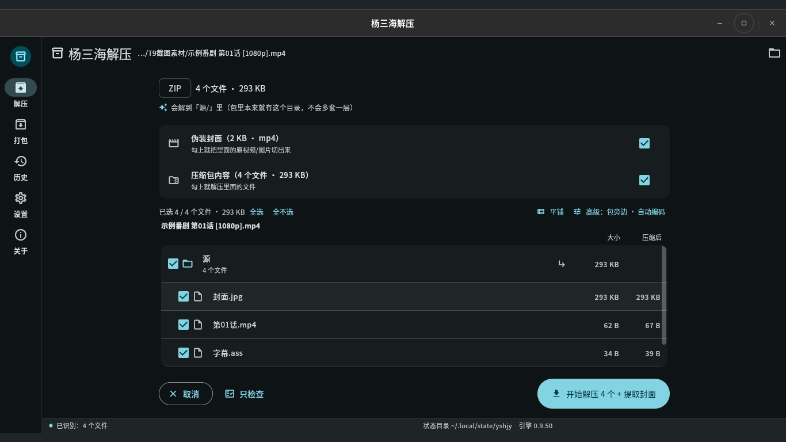
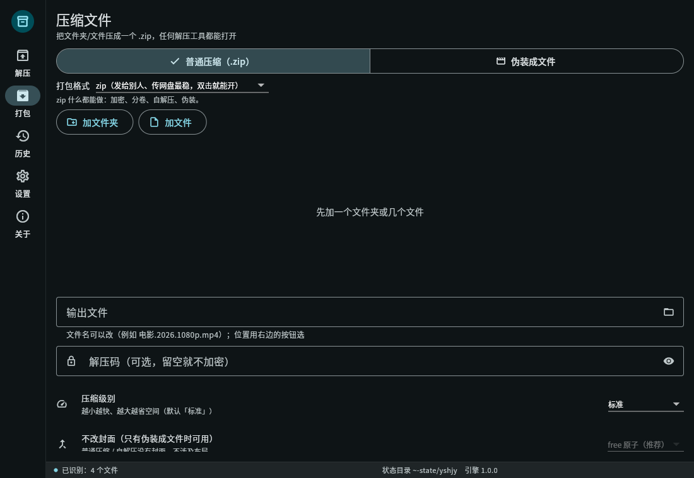
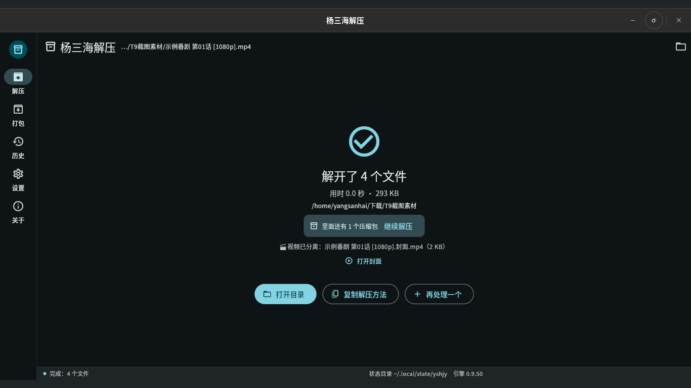
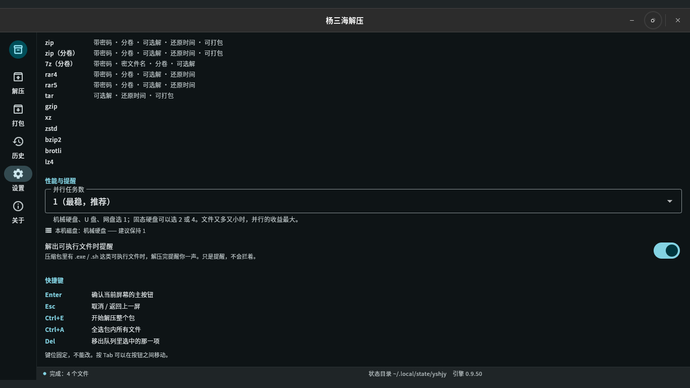
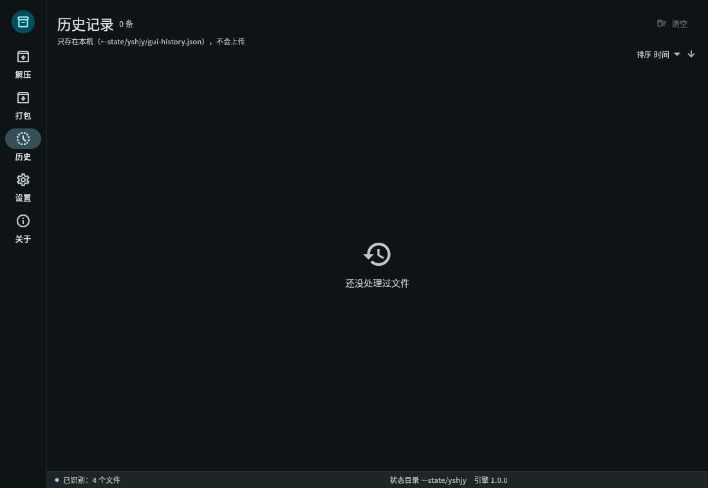
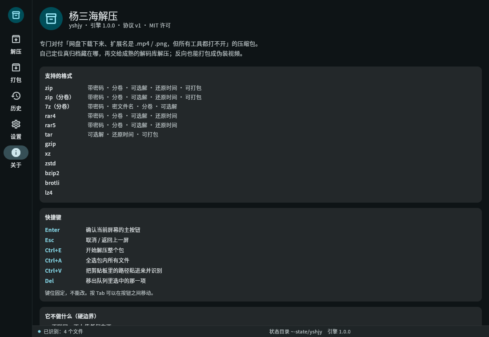

# yshjy — 楊三海解壓

> **將偽裝成影片/照片的壓縮檔一鍵還原為真實檔案。**
> 那些雲端硬碟上的 ".mp4" 檔案，其他工具都打不開？直接拖進來即可。

[簡體中文](README.md) ｜ **繁體中文** ｜ [English](README.en.md) ｜ [日本語](README.ja.md) ｜ [한국어](README.ko.md) ｜ [Русский](README.ru.md) ｜ [Español](README.es.md)

[](LICENSE)


<p align="center">
  
  
  
</p>

---

## 😵 為什麼需要這個專案

你下載了一個資源包，裡面是一堆 `.mp4` 檔案，還有一個 README 寫著：

> "密碼：xxxx —— 將每個 MP4 改名為 .zip，然後用 WinRAR 解壓縮"

於是你照做了，結果：

- 改名後雙擊 → **「檔案已損壞」** ❌
- 試了 7-Zip、試了手機內建的解壓縮工具 → **「不是壓縮檔」** ❌
- 有人在論壇提到 "#mode" → **哪都找不到** ❌
- 你重新下載，或直接放棄

原因很簡單：這些「影片」其實是壓縮檔被塞進 MP4 殼裡（用來繞過雲端硬碟的內容掃描），而壓縮檔**自身的目錄表已被故意破壞**，所以所有標準解壓縮工具都會宣告它已損壞。
**它們沒壞，只是被做成看起來壞了。**

市面上每一個解壓縮工具都在等待一個*正常*的壓縮檔；沒人能處理「看起來壞了」的那種。所以我寫了 yshjy：**不需要改名、不需要 "#mode"、不需要 7-Zip。**
拖入檔案，或執行一個指令即可。

---

## ✨ 功能介紹

**解壓縮**

- 透過內容識別壓縮檔，而非副檔名（`.mp4` / `.jpg` / `.pdf` 都可以；單個檔案包含多個壓縮檔也能處理）
- **中文檔名不會變成亂碼**，**中文密碼無需額外設定**（GBK 編碼的壓縮檔直接可用）
- 目錄表已損壞的壓縮檔會在**記憶體中修復**後再解壓縮 —— **磁碟上不會修改任何一個位元組**
- 多卷壓縮檔自動合併：7z 分卷、RAR 分卷、ZIP 的 `.z01/.z02…`，以及原始分割 `.001/.002…`
- `--list` 可在解壓縮前預覽內容；只解壓縮你需要的部分
- 完成後會告訴你**儲存位置，以及是否還有嵌套的壓縮檔**（嵌套的會自動提取）
- 如果目錄表完全消失，**救援模式**會從每個檔案的標頭重建清單 —— 你能拿回所有還能救回的東西
- 批次模式：排隊處理整個資料夾，一個壞檔不會阻止其他檔案

**打包（反向操作）**

- 將檔案偽裝成影片或圖片（MP4 會有真實的 `free` atom 結構；其他容器會在尾部附加）
- 每個套件都會**回讀並驗證**後才會報告完成 —— 你永遠不會得到「看起來好，其實壞了」的結果
- 可選分卷、密碼、誘餌資料、封面影片

**日常使用**

- 圖形介面，5 個頁面，**7 種介面語言**（簡體中文 / 繁體中文 / English / 日本語 / 한국어 / Русский / Español）
- **兩個頁面都支援拖放**：在首頁拖放以解壓縮，在打包頁面拖放以打包
- CLI 同樣支援 7 種語言，可腳本化（`--json` 會逐行輸出事件）
- **完全離線**：程式中沒有一行網路程式碼 —— 不是「我們承諾不會上傳」，而是**根本沒有上傳的能力**
- Linux 的 .deb 套件會安裝選單項目和 14 個檔案類型的右鍵選單；Windows 安裝程式會註冊 22 個副檔名和資料夾右鍵選單
- 兩種版本：**標準版**（常用格式，體積小，推薦）和**完整版**（為罕見格式預留空間 —— 目前支援範圍相同）

---

## 🖼 螢幕截圖

| 預覽 | 打包 | 設定 |
|---|---|---|
|  |  |  |

| 結果 | 歷史記錄 | 關於 |
|---|---|---|
|  |  |  |

繁體中文截圖在 `data/screenshots/` 中。
在**設定 → 介面語言** 中切換語言；立即生效，無需重新啟動。

---

## ✅ 命令列速成（20 秒上手）

```bash
# 解壓縮 —— 就是這麼簡單
yshjy movie.mp4

# 先預覽內容，不解壓縮
yshjy --list movie.mp4

# 帶密碼
yshjy -p "correct horse" game.mp4

# 排隊處理整個資料夾（一個失敗不會阻止其他檔案，先處理大檔）
yshjy Downloads/games/

# 只解壓縮壓縮檔的一部分
yshjy --select "*.exe" game.mp4          # 只解 .exe 檔案
yshjy --select "data/**" game.mp4        # 只解某個目錄
yshjy --select required game.mp4         # 跳過 .DS_Store 等檔案

# 同時處理兩個檔案（預設是順序處理 —— 對磁碟最溫和）
yshjy --jobs 2 Downloads/games/

# 機器可讀的事件流
yshjy --json archive.mp4 | jq .

# 強制救援模式處理損壞的壓縮檔
yshjy --rescue broken.zip

# 打包：將檔案偽裝成影片
yshjy ys MyGame/
yshjy ys MyGame/ -p "password"           # 加密
yshjy ys MyGame/ --split 2G              # 2 GB 分卷

# 有檔案打不開？產生一個診斷套件，可附加到 Issue
yshjy --report archive.mp4
yshjy --report --no-paths archive.mp4    # 路徑已刪除（用於公開張貼）
```

**實際檔案測試結果（非示範資料）：**

| 情境 | 結果 |
|---|---|
| 8.7 GB 真實偽裝壓縮檔（8 GiB 內部分卷 + 中文密碼） | 解壓縮 **8,589,934,592 位元組**，SHA-256 **位元組完全一致**（與手動腳本比對） |
| 在同一個 8.7 GB 檔案上執行 `--list` | **0.09 秒**（在修復 "讓 zip crate 偵測偏移" Bug 之前需要 109 秒） |
| 完整回歸測試 `bash tests/all.sh` | **62 通過 / 0 失敗 / 5 跳過** |
| 單元 + UI 測試 | Rust **448** 個單元測試通過；**440** 個 Flutter 測試通過 |
| Fuzzing | 讀取和寫入路徑目標長時間執行，**零崩潰** |
| 打包 → 解壓縮往返測試 | `diff -r` 乾淨，自檢通過 |

---

## 📦 我該下載哪個檔案？

**Linux**

| 檔案 | 安裝方式 | 適用對象 |
|---|---|---|
| `yshjy_1.0.0_amd64.deb` | `sudo apt install ./yshjy_1.0.0_amd64.deb` | 大多數使用者：選單項目 + 右鍵選單 |
| `yshjy-1.0.0-linux-x86_64.tar.gz`（標準版） | 解壓縮，將 `yshjy` 放入 `~/.local/bin/` | 無套件管理器，僅 CLI |
| `yshjy-full-1.0.0-linux-x86_64.tar.gz`（完整版） | 相同 | 為罕見格式預留空間（目前支援範圍相同） |

**Windows**

| 檔案 | 安裝方式 | 適用對象 |
|---|---|---|
| `yshjy-1.0.0-setup.exe` | 雙擊（每個使用者安裝，無 UAC 提示） | 大多數使用者：22 個副檔名 + 資料夾右鍵選單 |
| `yshjy-1.0.0-win-x64.zip`（可攜版） | 在任何地方解壓縮，執行 `yshjy_gui.exe` | 無需安裝，可從隨身碟執行 |
| `yshjy-1.0.0-win-x64-cli.zip`（CLI 版） | 解壓縮，將資料夾加入 PATH | 腳本、批次作業 |

> Windows 版本已捆綁 VC++ 運行時（`msvcp140` / `vcruntime140` / `vcruntime140_1`），所以在全新的 Windows 機器上無需先安裝任何東西。
> 所有三個版本都附帶 `SHA256SUMS.txt`。

---

## 📋 格式支援（誠實清單）

| 領域 | 支援的格式 | 備註 |
|---|---|---|
| **解壓縮** | ZIP（含 ZIP64）、7z、RAR（1.3 → 7）、TAR、GZIP、XZ、ZSTD、BZIP2、BROTLI、LZ4 | 空檔案、目錄、符號連結、長路徑都能處理 |
| **加密** | ZipCrypto、AES-256、7z AES-256 | 非 ASCII 密碼無需配置即可使用 |
| **分卷** | 7z 分卷、RAR 分卷、ZIP `.z01/.z02…`、原始分割 `.001/.002…` | 缺失分卷會明確報告，不會悄悄跳過 |
| **偽裝容器** | 任意：MP4 使用真實 `free` atom，其他格式在尾部附加 | 圖片和 PDF 也經過測試 |
| **救援模式** | ZIP 偏移修復 + 本地標頭重建 + ZIP64 額外欄位 | 其他格式尚未支援 |
| **打包** | ZIP / 7z（分卷、密碼） | 不支援產生 RAR（見下文） |

> 完全基於**開源**實作。RAR 只能解壓縮，因為 RAR 的官方授權禁止產生壓縮檔。核心功能**不依賴任何外部程式** —— 你不需要安裝 7-Zip、WinRAR 或 unrar。
>
> **唯一例外是 "MKV 附件" 佈局**（`--layout L8`）：它會呼叫你系統上已安裝的 **ffmpeg**（[ffmpeg.org](https://ffmpeg.org/)，LGPL/GPL 自由軟體）來重新封裝封面影片到 MKV，並將壓縮檔儲存為附件。
> 我們不會捆綁、修改或重新分發 ffmpeg —— 它只會被呼叫一次，且**只有在你**安裝了它時才會呼叫。沒有 ffmpeg 的話，工具會回退到 `free`-atom 佈局並說明；它永遠不會為了看起來成功而寫入一個假的 MKV。其他所有功能都不需要 ffmpeg。

---

## 🆚 與普通解壓縮工具的比較

| 功能 | 典型工具 | **yshjy** |
|---|---|---|
| 透過內容識別，忽略副檔名 | 部分支援 | ✅ |
| 找到隱藏在檔案中間或末尾的壓縮檔 | ✗ | ✅（包括單個檔案中包含多個壓縮檔） |
| 非 ASCII 檔名保持可讀 | ✗（GBK 壓縮檔總是亂碼） | ✅ 四層回退（UTF-8 旗標 → UTF-8 → GB18030 → 最後手段） |
| 非 ASCII 密碼無需設定 | ✗（需要手動切換編碼） | ✅ |
| 修復已損壞的目錄表 | ✗ | ✅ 在記憶體中修復，原始檔案不受影響 |
| 目錄表無法挽救時的救援模式 | ✗ | ✅ 從檔案標頭重建清單 |
| 打包時驗證自己的輸出 | ✗ | ✅ 回讀並大聲報錯 |
| 圖形介面 | ✗（幾乎都是 CLI） | ✅ Linux + Windows，5 個頁面，7 種語言 |
| 完全離線 | 有時 | ✅ 程式中完全沒有網路程式碼 |

**一句話總結：** 其他工具會說「檔案已損壞」。這個工具會告訴你**發生了什麼、為什麼，以及還能救回多少。**

---

## 🔧 從原始碼建置

```bash
# 需要 Rust 1.85+（2024 版本）
git clone https://github.com/yangsanhai/yshjy
cd yshjy
cargo build --release
# 輸出：target/release/yshjy（單個檔案，約 9 MB，無外部依賴）

install -Dm755 target/release/yshjy ~/.local/bin/yshjy   # 僅 CLI

# GUI（需要 Flutter 3.44+）
cd gui && flutter build linux --release && cd ..
bash scripts/build-deb.sh     # 在 dist/ 中產生 .deb
```

測試：

```bash
cargo test                                   # 448 個單元測試
cargo clippy --all-targets -- -D warnings    # 靜態檢查（零警告）
bash tests/all.sh                            # 完整回歸測試，62 個項目，約 5 分鐘
cd gui && flutter test                       # 440 個 UI 測試
```

---

## 🌍 介面語言（7 種）

簡體中文 · 繁體中文 · English · 日本語 · 한국어 · Русский · Español

- 在**設定 → 介面語言** 中切換；立即生效
- CLI：`--lang en`（或 `ja` / `ko` / `ru` / `es` / `zh-TW`）
- 想要自己的語言？在 `locales/` 中放入一個 `.toml`，在 `gui/assets/l10n/` 中放入一個 `.json` —— **不需要修改程式碼**；缺少的鍵會回退到英文，而不是顯示空白或方塊

---

## 💥 它崩潰了 —— 如何回報？

1. 執行 `yshjy --report`
   這會在當前目錄中寫入 `yshjy-report-<時間>.zip`，包含最新的崩潰記錄（`crash/` 資料夾：崩潰位置、回溯、命令列 —— **密碼已自動替換為 `<redacted>`**）
2. 將該 zip 附加到 Issue

不需要套件？日誌位於 `~/.local/state/yshjy/crash/`
（Windows：`%LOCALAPPDATA%\yshjy\crash\`）。

在公開張貼之前，請執行 `yshjy --report --no-paths` —— 路徑會變成 `<home>` 形式的占位符，而不是你的使用者名稱。

> 絕不會自動上傳任何東西（程式中完全沒有網路程式碼）。是否發送以及發送給誰，完全由你決定。

---

## ❓ 常見問題

**Q: 為什麼不直接用 WinRAR / 7-Zip？**
A: 它們無法*看到*隱藏在影片中間的壓縮檔，或者目錄表已損壞的壓縮檔。這是設計如此，不是 Bug。WinRAR 在 Windows 上是付費軟體，且在 Linux 上無法使用。

**Q: 它能讀取加密壓縮檔的密碼嗎？**
A: 不能 —— 這在數學上是不可能的，也是加密的全部意義。它可以在解壓縮前告訴你**有多少個項目被鎖定**，這樣你就能確認你得到的密碼是否正確，而不是在解壓縮到一半時才發現。

**Q: 那麼「自動密碼嘗試」到底是什麼意思？**
A: 在你**已經擁有**的加密壓縮檔上，它會嘗試你**自己記錄下來**的密碼，一個接一個（檢查加密項目的前幾 KB 就足夠驗證）。它無法登入任何地方，也無法連接到其他機器 —— 入侵電腦需要在該機器上有一個遠端入口，這比解壓縮工具高了好幾個層級。

**Q: 有安全風險嗎？**
A: 內建防禦：路徑遍歷阻擋 (`../../etc/passwd`)、zip 炸彈防護（壓縮比 + 總大小），以及在提取出可執行檔時發出警告。但要誠實面對自己：這些「改名後解壓縮」的套件是惡意軟體的高發地。解壓縮前請先掃描。

**Q: 它能給我一個完整的、可播放的影片嗎？**
A: 能。`yshjy --extract-cover archive.mp4`，或者在 GUI 中只勾選「偽裝封面」 —— 封面本身已經是一個完整的 MP4，會原封不動地提取出來。

**Q: 它會修改我的原始檔案嗎？**
A: **絕不會。** 所有修復都在記憶體中進行；磁碟上的檔案不會被修改，一個位元組都不會改。

**Q: 為什麼能解壓縮 RAR 但不能建立 RAR？**
A: RAR 的壓縮演算法是專有的，其授權只允許解壓縮。這個專案僅使用開源實作。

**Q: 手機版？**
A: 尚未支援。Android / iOS 還沒有開始（這台機器上沒有 SDK/NDK，且 Apple 的建置需要 Mac）。目前的版本：Linux 和 Windows。

---

## 🚫 這個工具故意不做的事

這些不是「尚未」實作 —— 它們是**設計上就不在範圍內**的，這樣使用者和未來的貢獻者就能清楚地知道界限在哪裡。

- **不提供字典攻擊、不暴力破解。** 密碼候選只來自兩個地方：你**自己記錄**的密碼，以及打包者**在壓縮檔旁邊的 README 中發布**的密碼。
- **不內建常用密碼清單。** 這相當於發布一個小型字典。舊的「嘗試內建常用密碼」開關從來沒有實際功能（一個假的殼），**已被移除**。
- **不提供字典檔選項，且候選上限是硬性限制。** `max_candidates` 有硬性上限；沒有任何配置能將其變成暴力破解工具（測試會強制執行這一點）。
- **不聯網、不上傳。** 不是「我們承諾不會發送」 —— 程式中**完全沒有網路程式碼**。
- **不收集密碼。** 從 README 中抓取的密碼**只會嘗試後丟棄**，永遠不會寫入你的密碼本。密碼本由你自己編輯，或透過 `--import-passwords` 填入。
- **不修改你的檔案。** 所有修復都在記憶體中進行。

**真正的風險是其他人交給你的壓縮檔。** 這些套件是惡意軟體的高發地。工具會防禦（阻擋 `../` 遍歷、防護 zip 炸彈、警告可執行檔），但**解壓縮前請先掃描。**

另外：**反向打包**（`ys`）可以將檔案偽裝成影片，這項功能可能被用於欺騙。請僅將其用於個人備份和合法分享（見免責聲明）。

---

## 🛠 設計與開發者文件

- `DESIGN.md` —— 產品設計（需求、功能、決策日誌）
- `docs/ARCHITECTURE.md` —— 架構
- `docs/INTERNALS.md` —— **內部概述**：目前程式碼的樣子（模組職責、依賴、機制，由 `scripts/scan-src.py` 產生）
- `docs/TODO.md` —— **唯一的完整性單一真實來源**
- `docs/CLI-SPEC.md` / `docs/UI-SPEC.md` —— CLI 和 UI 規範
- `docs/` 中的其他文件 —— 每種格式的測量和沿途遇到的陷阱

想要貢獻？見 [CONTRIBUTING.md](CONTRIBUTING.md)。

---

## 💖 支持專案

- 給倉庫點星 —— 你能做的最有用的事，而且是免費的
- 針對失敗的套件開一個 Issue：**附加 `yshjy --report` 產生的套件**，這是最有價值的貢獻
- 捐款管道尚未設定；設定後會列在這裡

---

## ⚖️ 授權與免責聲明

本專案採用 [MIT 授權](LICENSE)：你可以自由使用、修改、再散布（包括商用），唯一要求是保留著作權聲明與授權原文（見 `LICENSE` 與各原始碼檔開頭）。

用到的第三方開源函式庫各自仍歸各自的授權，完整清單與授權原文隨軟體提供：「關於」頁 → 「開源授權」，查看不需要連線。

**免責聲明**：本工具僅供**個人備份與合法分享**使用。請勿用於規避法令或散布侵權內容。使用者應自行承擔因使用本工具產生的一切後果。
